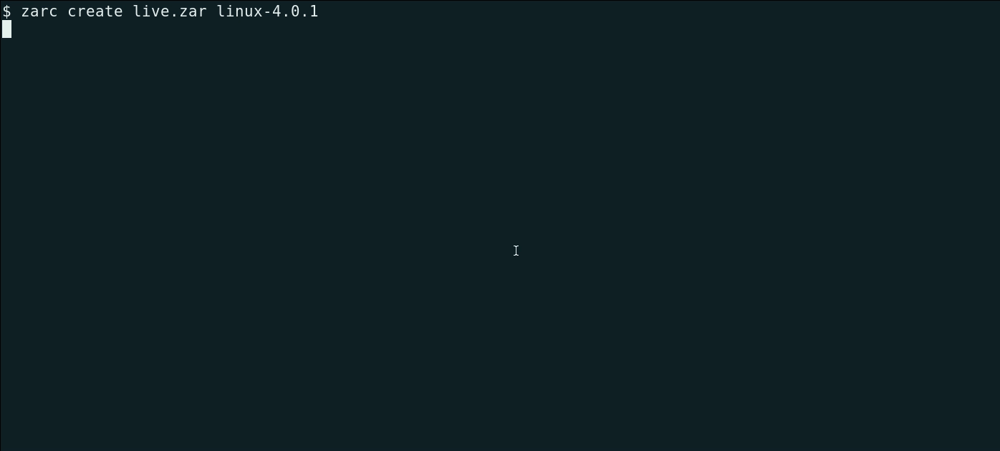
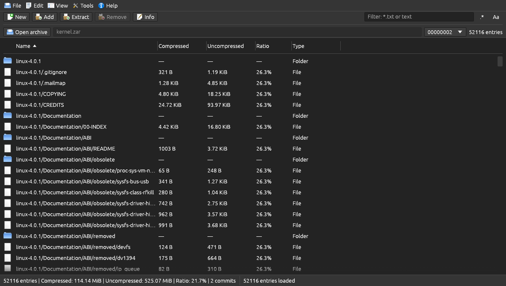

# ZAR

[](https://crates.io/crates/zarlib)
[](https://docs.rs/zarlib)
[](https://pypi.org/project/pyzarlib/)
[](https://github.com/brmmm3/zar-rs/actions/workflows/ci.yml)
[](LICENSE-MIT)

ZAR is an archive format and toolkit with compression, deduplication, and
commit-based history. It is written in Rust and includes a command-line tool,
a desktop GUI, a reusable library, language bindings, and a network copy tool.

See the [changelog](./CHANGELOG.md) for recent project updates. See
[CONTRIBUTING.md](./CONTRIBUTING.md) for development setup, checks, and pull
request guidance.

- **[`zarc`](./zarlib-cli/README.md)** is the command-line application.
- **[`zarg`](./zarlib-gui/README.md)** is the egui desktop archive manager.
- **[`zarlib`](./doc/zarlib-developer-guide.md)** is the reusable archive
  format and operations library.
- **[`zcopy`](./zcopy/README.md)** copies file trees between machines over the
  network using compressed, optionally encrypted ZAR batches. It can update
  missing or newer files on the destination or save a complete packed archive.
- **[`zarmcp`](./zarmcp/README.md)** provides local MCP tools for AI clients to
  inspect, read, and manage archives, with read-only and tool-allowlist modes.
- **[`zarmount`](./zarmount/README.md)** mounts ZAR archives as read-only
  FUSE filesystems on Linux.

The Rust package names for `zarc` and `zarg` are `zarlib-cli` and
`zarlib-gui`, respectively; the executable names remain unchanged.

## Choose your path

- **New users:** [install](#installers-and-packages), then follow the
  [quick start](#quick-start) to create, inspect, update, restore, and verify an
  archive. Prefer a desktop interface? See the [zarg guide](./zarlib-gui/README.md).
- **Developers:** start with the [Rust API quick start](#rust-api-quick-start),
  then explore the [bindings](#language-bindings-and-runtime-packages),
  [operation examples](./doc/zarlib-developer-guide.md#examples-matching-the-zarc-commands),
  and API documentation. For AI clients, see the [MCP server](./zarmcp/README.md).
- **Format implementers:** see the [format implementer path](#format-implementer-path)
  for framing, versioning, integrity, encryption, and compatibility.
- **Operators:** use the [backup and restore guidance](#backup-and-restore-operations),
  check [limitations](#limitations), and consult [troubleshooting](#troubleshooting).

## See ZAR in action

This recording uses a release build of `zarc` to archive the 525 MiB Linux
4.0.1 source tree, add an edited Makefile as a second commit, inspect the
history, and extract the original Makefile from the first commit. The final
`cmp` verifies it against the original. The displayed timings are from this
one run and depend on the machine, storage, and cache state.



The release build of `zarg` can browse the same archive and select a commit:



## What makes ZAR different

| Feature | ZAR | zip | tar.gz | 7z |
| --- | --- | --- | --- | --- |
| Fast parallel compression (zstd, block based) | ✅ | ❌ (deflate) | ❌ (single-threaded gzip) | ❌ (slow LZMA) |
| Random access to a single file | ✅ | ✅ | ❌ (stream must be read) | ⚠️ solid blocks |
| Commit-based updates and compaction | ✅ | ⚠️ append only | ❌ | ❌ |
| History retained until explicitly compacted or removed | ✅ | ❌ | ❌ | ❌ |
| Content deduplication (within one create/add) | ✅ | ❌ | ❌ | ⚠️ solid only |
| Modern authenticated encryption (AES-256-GCM / ChaCha20-Poly1305, Argon2id) | ✅ | ⚠️ weak ZipCrypto or AES | ❌ needs wrapper | ✅ AES-CBC |
| Encrypt data only, header only, or both; per-commit passwords | ✅ | ❌ | ❌ | ⚠️ |
| Per-block checksums and damage recovery (`check --recover`) | ✅ | ⚠️ CRC | ❌ | ⚠️ |
| Safe extraction (no path traversal, no-follow on Unix) | ✅ | varies | varies | varies |
| Library integrations: Python, C, C++, Go, Java, C#, Lua, WASI | ✅ | varies | ❌ | varies |

Highlights:

- **Speed.** Data is split into blocks compressed in parallel with Zstandard.
  In one [Linux Core i7 benchmark](./doc/benchmarks/benchmark-report-linux-x86_64-core-i7-linux-4.0.1.md)
  of the 525 MiB Linux 4.0.1 source tree, hot-cache unencrypted ZAR creation
  took 0.98–1.03 s and full extraction took 0.89–0.91 s. The same run produced a
  smaller 7z archive, but 7z creation took 26.86–27.61 s. Results depend on
  hardware, data, settings, and cache state. See
  [how to run benchmarks](./doc/benchmarks/README.md#running-benchmarks) and
  the [benchmark overview](./doc/benchmarks/README.md) for reports and charts.
  The [archive benchmark workflow](./.github/workflows/benchmark-archives.yml)
  currently runs on Windows and Linux; each run uploads its generated reports
  and charts from the `doc/benchmarks/` folder as workflow artifacts.
- **ZIP, 7z, RAR, ISO, TAR, and gzip extraction/import.** Pass a `.zip`, `.7z`, `.rar`, `.iso`, `.tar`,
  `.tar.gz`, `.tgz`, or standalone `.gz` file to `zarc extract` to write its
  contents directly; regular files are written in parallel. Standalone gzip
  extraction removes the `.gz` suffix from the output filename. These formats
  can also be passed to create or add, where their contents are imported under
  their paths in the new ZAR commit. This works through `zarlib`, `zarc`,
  `zarg`, and the language bindings. Encrypted ZIP/7z/RAR archives and
  ZIP/7z/RAR links are not supported. Multi-volume RAR archives and RAR
  special entries are rejected. ISO images use their ISO 9660 filesystem
  (Rock Ridge preferred, then Joliet, then primary); ISO links and special entries
  are rejected, and UDF-only images are not supported. ISO import is limited
  to 100,000 entries, 16 MiB of directory metadata, and 64 directory levels.
  TAR symbolic links are preserved where the host supports
  them; hard links are imported as regular files. TAR paths with harmless `.`
  components are normalized; parent traversal and special entries are rejected.
  Source archive timestamps are not retained; timestamp options record the
  staged files' import-time filesystem timestamps instead. 7z entries using COPY, LZMA/LZMA2, BZip2, PPMD,
  DEFLATE, Brotli, LZ4, or Zstandard are supported.
- **Batch archive conversion.** `zarc convert FOLDER` converts supported
  archive files directly inside a folder into separate `.zar` files, with an
  optional fnmatch filename filter and a separate output folder.
- **Commit-based history.** `add` records new versions, while `remove` records
  tombstones. Historical states remain available until commits are removed or
  compacted with `join`. Mutations stage a replacement archive; joining can
  rewrite compressed data.
- **History inspection and undo.** `zarc info` and `zarc references` show
  cross-commit references; the GUI has a reference viewer. `remove-commits`
  removes selected commits while retaining at least one, subject to dependency
  validation for readable history. The GUI also supports undo for unsaved edits.
- **Desktop workflows.** `zarg` supports drag-and-drop, selected-file
  extraction, archive testing and benchmarking, and file-manager context
  actions for creating, opening, extracting, and testing archives.
- **Configurable defaults.** `zarc.json` supplies per-command defaults from
  the current directory or user configuration directory. Command-line options
  override these settings, and `--no-config` disables them.
- **Custom archive metadata.** Store arbitrary key/value pairs alongside the
  archive history, independently of per-file permissions and timestamps. Use
  `zarc meta` to list, set, or remove values; each update appends a
  metadata-only commit.
- **Security by design.** Authenticated encryption with flexible scope,
  commit-specific passwords, bounded KDF parameters, strict canonical UTF-8
  archive paths, and extraction that cannot escape the destination.
- **Integrity.** Every frame is checksummed, `check` verifies the entire
  archive, and recovery scans past damaged regions. Extraction can recheck
  block checksums automatically, always, or never.
- **One core, many front ends.** CLI, GUI, language bindings, and a
  server-side WASI component share the same Rust implementation and behavior.
- **Network copy.** `zcopy` transfers files missing from the destination or
  newer by modification time, or sends a complete packed archive. Encryption
  is optional; without a password the connection is not authenticated.

## Archive structure and history

An archive contains a container header followed by one or more commits. Each
commit carries data blocks and a header describing its changes; offset fields
connect the commits. This simplified diagram shows their physical order:

```text
ZAR archive
┌──────────────────┐
│ Container header │
├──────────────────┤
│ Commit 1         │  data blocks + header (file additions)
├──────────────────┤
│ Commit 2         │  data blocks + header (updates or additions)
├──────────────────┤
│ Commit 3         │  header (removals or metadata)
└──────────────────┘
```

**Current contents** are the files you see when the commit changes are
applied in order through the latest commit. **Retained history** lets you
inspect or extract an earlier state, even after a later commit updates or
removes a file. **Compaction** with `join` combines a chosen contiguous range
of commits into one, keeping the state at the end of that range but discarding
the individual intermediate states within it. Custom archive-level key/value
metadata is also stored in commits; later values replace earlier ones, and
removals hide earlier values. Metadata updates append a commit with no file
changes rather than rewriting existing commits. This is separate from optional
per-entry metadata such as permissions and timestamps.

### Example: a file changes over time

Run these commands in a new, empty directory. The shown commit IDs are for this
fresh archive; use `zarc info` to find the IDs in an existing archive.

```sh
printf 'draft\n' > notes.txt
printf 'obsolete\n' > old.txt
zarc create history.zar notes.txt old.txt       # commit 00000001

printf 'final\n' > notes.txt
zarc add history.zar notes.txt                  # commit 00000002
zarc remove history.zar old.txt                 # commit 00000003

zarc info history.zar                           # show all three commits
zarc list history.zar                           # current contents: notes.txt
zarc extract history.zar --to 00000001 -o before # draft and old.txt
```

| After | Current contents | What history retains |
| --- | --- | --- |
| `create` | `notes.txt` = `draft`, plus `old.txt` | The initial state in commit 1 |
| `add` | `notes.txt` = `final`, plus `old.txt` | The draft in commit 1 and the update in commit 2 |
| `remove` | `notes.txt` = `final` | Both earlier states, including `old.txt`; removal records a deletion rather than erasing its earlier data |

`remove` changes the archive, not the original files on disk. Now compact all
three commits:

```sh
zarc join history.zar --from 00000001 --to 00000003
zarc info history.zar                           # one new joined commit
zarc list history.zar                           # still just notes.txt
```

The joined archive still contains `notes.txt` with `final`, but the original
three commit IDs and the earlier `draft` and `old.txt` states from that range
are no longer available through that archive. Joining can rewrite data and may
reduce size, but does not guarantee a smaller archive. Commits outside a joined
range remain in place. Keep a separate copy before joining if you need the
individual historical states. See the [CLI guide](./zarlib-cli/README.md#append-remove-and-compact-commits)
for command details and encrypted-archive limitations.

## Benchmarks

The [Linux Core i7 benchmark report](./doc/benchmarks/benchmark-report-linux-x86_64-core-i7-linux-4.0.1.md)
measured the 525.1 MiB Linux 4.0.1 source tree on 2026-11-20 using an Intel
Core i7-10700 and SSD storage. These are unencrypted, hot-cache results; each
time range covers two runs. The full report also includes encrypted and
cold-cache results.

| Format | Archive size | Compression | Full extraction | Extract 3 files |
| --- | ---: | ---: | ---: | ---: |
| ZAR | 115.3 MiB | 0.98–1.03 s | 0.89–0.91 s | 0.108–0.118 s |
| ZIP | 150.3 MiB | 11.86–11.90 s | 4.23–4.35 s | 0.007–0.008 s |
| 7z | 81.1 MiB | 26.86–27.61 s | 6.11–6.15 s | 3.794–3.806 s |
| tar | 562.7 MiB | 0.63–0.65 s | 0.95–0.98 s | 0.069–0.070 s |
| tar.gz | 122.2 MiB | 12.99–13.14 s | 2.30–2.39 s | 2.251–2.286 s |

Tar is an uncompressed baseline. Encryption methods differ: the ZIP test uses
legacy ZipCrypto, while tar and tar.gz use an OpenSSL encryption wrapper.
Results depend on the hardware, data, settings, and cache state; see the
[full report](./doc/benchmarks/benchmark-report-linux-x86_64-core-i7-linux-4.0.1.md) for
throughput, verification limitations, tool settings, and methodology.

More recent dataset reports, each with a linked chart, are available for:

| Dataset | Linux, Core i7-10700 | Windows, Core Ultra 7 265HX |
| --- | --- | --- |
| Linux 4.0.1 source | [Report](./doc/benchmarks/benchmark-report-linux-x86_64-core-i7-linux-4.0.1.md) | [Report](./doc/benchmarks/benchmark-report-windows-x86_64-core-u7-linux-4.0.1.md) |
| Linux 6.1.1 | [Report](./doc/benchmarks/benchmark-report-linux-x86_64-core-i7-linux-6.1.1.md) | [Report](./doc/benchmarks/benchmark-report-windows-x86_64-core-u7-linux-6.1.1.md) |
| Duplicate icon tree | [Report](./doc/benchmarks/benchmark-report-linux-x86_64-core-i7-duplicates.md) | [Report](./doc/benchmarks/benchmark-report-windows-x86_64-core-u7-duplicates.md) |
| Icons | [Report](./doc/benchmarks/benchmark-report-linux-x86_64-core-i7-icons.md) | [Report](./doc/benchmarks/benchmark-report-windows-x86_64-core-u7-icons.md) |
| Small archive | [Report](./doc/benchmarks/benchmark-report-linux-x86_64-core-i7-small_archive.md) | [Report](./doc/benchmarks/benchmark-report-windows-x86_64-core-u7-small_archive.md) |

For example, on the duplicate icon tree the Linux report measures a 23.6 MiB
ZAR versus a 43.1 MiB 7z archive, with unencrypted hot-cache creation taking
0.15–0.17 s and 5.38–5.48 s respectively. Windows results are affected by
the system configuration, including antivirus scanning. The comparison runner
caches completed runs in `.benchmark_cache` for resumption and removes the
cache after report generation completes. See
`python scripts/benchmark_archivers.py --help` for current options and the
[benchmark overview](./doc/benchmarks/README.md) for methodology and safety
precautions.

## Limitations

- `zarc extract` restores symlinks and devices only when explicitly requested.
  Device creation may require privileges, and symlink targets must remain
  within the extraction root.
- `create` and `add` can record entry modification times with
  `--modification-time` (`--mt`), creation times with `--creation-time`
  (`--ct`), and access times with `--access-time` (`--at`). Creation- or
  access-time recording fails if a stored entry's filesystem does not provide
  it. Access times can change as files or directories are read and depend on
  filesystem policies. Archive extraction does not restore these timestamps. `zcopy` transfers and
  restores file modification times separately in its unpack mode.
- `zarc add` can use passwords for existing encrypted commits. The CLI
  `remove` and `join` commands do not accept those passwords: `remove` cannot
  operate when encrypted commits need passwords, and `join` skips locked
  commits rather than including them. Password-aware Rust library operations
  support removal and joining with credentials, subject to their own validation
  rules.
- Listing and extraction without passwords can omit commits with locked
  headers, producing a partial view. A visible data-encrypted commit still
  requires its password for extraction. Use passwords for all relevant
  commits when a complete result is required.
- `zcopy` is a one-way copy, not a mirror: it does not propagate deletions
  and compares whole-second modification times rather than file contents.
  See its [README](./zcopy/README.md) for cache and concurrency details.
- Compression ratio depends on data and settings. Some 7z configurations
  produce smaller archives in the provided benchmarks.

## Language bindings and runtime packages

`zarlib` is available through language bindings and a WASI component. They
expose archive operations through their respective language or runtime
interfaces; see each package's documentation for its API and limitations.

| Package | Language/runtime | Mechanism |
| --------- | ---------- | ----------- |
| **[`pyzarlib`](./pyzarlib/README.md)** | Python | PyO3 extension module |
| **[`czarlib`](./czarlib/README.md)** | C | JSON and streaming C ABI (shared/static library and header) |
| **[`cxxzarlib`](./cxxzarlib/README.md)** | C++ | CXX bridge |
| **[`gozarlib`](./gozarlib/README.md)** | Go | cgo over `czarlib` |
| **[`luazarlib`](./luazarlib/README.md)** | Lua 5.4 | Lua C module over `czarlib` |
| **[`jzarlib-ffm`](./jzarlib-ffm/README.md)** | Java 25+ | Foreign Function & Memory API over `czarlib` |
| **[`jzarlib-jni`](./jzarlib-jni/README.md)** | Java | JNI shim over `czarlib` |
| **[`csharpzarlib`](./csharpzarlib/README.md)** | C# (.NET 10) | P/Invoke over `czarlib` |
| **[`wasizarlib`](./wasizarlib/README.md)** | WebAssembly / Node.js | WASI Preview 2 component with a WIT interface; Node support via Jco and the Preview 2 shim |

The Go, Java, C#, and Lua wrappers load the `czarlib` shared library, which is built
with `cargo build -p czarlib`.

For streaming regular-file data, consult each binding's streaming
documentation. Archive input or output must still be seekable; a failed
operation can leave a partial archive or extracted output.

The WASI component is built for `wasm32-wasip2`; its filesystem access is
limited to directories preopened by the server-side WASI runtime. Node.js
applications can run it through Jco and the Preview 2 shim; Node's built-in
`node:wasi` API is Preview 1 and does not directly run this component.

The archive format stores data in commits. Commits support compressed and
deduplicated data blocks, an ordered logical table of contents (TOC), integrity
checks, and optional password-based encryption. See the
[format description](./doc/zar-file-format.md) for details.

Language bindings expose `read_custom_metadata` and
`update_custom_metadata` through their operation APIs. Reading returns the
effective key/value map; updating accepts a `set` object and/or a `remove`
array and appends a metadata-only commit. Use strings, signed integers, or
finite floating-point values; `zar.` keys are reserved. These operations
currently require an unencrypted archive.

## Build

Install a Rust toolchain that supports the 2024 edition, then build or test the
workspace from the repository root:

```sh
cargo build --workspace --release
cargo test --workspace
```

Run the CLI directly from the workspace:

```sh
cargo run --release -p zarlib-cli -- --help
cargo run --release -p zarlib-gui
cargo run --release -p zarlib-zcopy -- --help
```

For MCP clients, build `zarmcp` with `cargo build --release -p zarmcp` and
follow the [server configuration and security guidance](./zarmcp/README.md).

Build the server-side WASI component separately:

```sh
rustup target add wasm32-wasip2
cargo build --release -p wasizarlib --target wasm32-wasip2
```

Or install the executable into Cargo's binary directory:

```sh
cargo install --path zarlib-cli
```

## Installers and packages

### Install prebuilt binaries with cargo-binstall

Starting with the first release containing cargo-binstall metadata and assets,
install the packages using their Cargo package names:

```sh
cargo binstall zarlib-cli    # zarc
cargo binstall zarlib-gui    # zarg
cargo binstall zarlib-zcopy  # zcopy
cargo binstall zarmcp
cargo binstall zarmount      # Linux only
```

These commands require the corresponding package version to be published on
crates.io and its binary archive to be present in the matching GitHub release.
`zarmcp` and `zarmount` are not currently published to crates.io. Until they
are, use a checkout of a matching released version:

```sh
cargo binstall --manifest-path ./zarmcp zarmcp
cargo binstall --manifest-path ./zarmount zarmount
```

For crates.io publication, publish the matching `zarlib` version first, then
`czarlib` before `zarmcp`; `zarmount` also depends on `zarlib`.

The prebuilt archives target baseline x86-64 or ARM64 on Linux, macOS and
Windows; `zarmount` is available only on Linux and requires FUSE 3. Linux musl
targets use the static archives. See the [zarmount guide](./zarmount/README.md)
for mount requirements.

Each versioned release provides two x86-64 variants:

- **v3** is intended for newer CPUs with x86-64-v3 features,
  including AVX2.
- **v1** targets the baseline x86-64 instruction set for older CPUs.

See [x86-64 release compatibility](#x86-64-release-compatibility) for
platform requirements and release details.

The [packaging](./packaging) directory contains installer definitions for the
`zarc` CLI and the `zarg` GUI. The Windows suite installer also includes
`zcopy`:

- **Windows:** an [Inno Setup](https://jrsoftware.org/isinfo.php) script
  (`packaging/windows/zar-rs.iss`) that can add `zarc` and `zcopy` to the
  `PATH`. Local winget, Chocolatey, and Scoop package definitions are also
  provided; see the packaging guide for their installation behavior.
- **Linux:** `packaging/linux/build-packages.sh [deb|rpm|appimage|flatpak|all]`
  builds `.deb`, `.rpm`, AppImage and Flatpak packages into `dist/`. An
  [Arch Linux PKGBUILD](./packaging/linux/arch/PKGBUILD) is also provided.
- **macOS:** `packaging/macos/build-packages.sh [dmg|pkg|all]` builds a `.dmg`
  with `Zarg.app` and a `.pkg` that also installs `zarc`.

```sh
iscc /DAppVersion=0.15.0 packaging\windows\zar-rs.iss  # Windows
packaging/linux/build-packages.sh deb                  # Linux
```

See [packaging/README.md](./packaging/README.md) for prerequisites and options.

## Quick start

Install `zarc` using an [installer or package](#installers-and-packages), or
run `cargo install --path zarlib-cli` from a local checkout. The commands below use
an unencrypted archive and existing input paths relative to your working
directory; start with no `backup.zar` in that directory.

```sh
# Create an archive from files and directories
zarc create backup.zar documents/ src/ notes.txt

# Inspect the archive and list its current contents
zarc info -v backup.zar
zarc list backup.zar

# After changing files, append their new versions
zarc add backup.zar documents/

# Verify the archive, then restore its current contents
zarc check backup.zar
zarc extract backup.zar --output ./restored/

# Inspect and restore the initial state (commit ID from zarc info)
zarc list backup.zar --to 00000001
zarc extract backup.zar --to 00000001 --output ./restored-initial/

# Store, inspect, and remove custom archive metadata
zarc meta backup.zar --set project=example --set revision=3
zarc meta backup.zar
zarc meta backup.zar --remove revision
```

`add` updates the paths supplied to it; it does not automatically remove paths
deleted from disk. Use `zarc remove` for archive paths you want to delete.
`info` shows the actual commit IDs; the first commit in this fresh example is
`00000001`. Use `zarc <command> --help` for options and the
[CLI guide](./zarlib-cli/README.md) for encryption, conversion, and other workflows.
Custom metadata values that parse as integers or finite floating-point numbers
are stored numerically; other values are stored as strings. Keys beginning
with `zar.` are reserved. `zarc meta` currently requires an unencrypted
archive. The Rust API also exposes `read_custom_metadata` and
`update_custom_metadata`; see the
[developer guide](./doc/zarlib-developer-guide.md#custom-archive-metadata).
The language bindings expose the same operations through their APIs; the
Python CLI `zarc-py` does not yet include a `meta` command.

For repeatable defaults, place `zarc.json` in the current directory or the
per-user configuration directory. Use `--no-config` to ignore it; see the
[configuration guide](./zarlib-cli/README.md#configuration-defaults) for
precedence, examples, and password-handling guidance. Extraction defaults to
`--recheck-block-checksums auto`; use `always` or `never` to override it.

## Rust API quick start

For a Rust project alongside this checkout's `zarlib` directory, add a path
dependency (adjust the path to your checkout):

```toml
[dependencies]
zarlib = { path = "../zarlib" }
```

For example, create and check an unencrypted archive, propagating errors:

```rust,no_run
use std::path::PathBuf;
use zarlib::operations::{check_archive_with_recovery, create_archive};

fn main() -> Result<(), Box<dyn std::error::Error>> {
    create_archive("backup.zar", &[PathBuf::from("documents")])?;
    let report = check_archive_with_recovery("backup.zar", false, None)?;
    println!("Verified {} commits", report.commits);
    Ok(())
}
```

The input must exist and `backup.zar` must not already exist. See the
[developer guide](./doc/zarlib-developer-guide.md#high-level-api) for listing,
extraction, and [more examples](./doc/zarlib-developer-guide.md#examples-matching-the-zarc-commands),
or use the [language bindings](#language-bindings-and-runtime-packages).
For block-by-block regular-file input and output with seekable archives, see
the [streaming API](./doc/zarlib-developer-guide.md#streaming-regular-files).
For Rust API documentation, run `cargo doc -p zarlib --no-deps --open` from the
workspace root.

## Format implementer path

The [file architecture](./doc/zar-file-format.md) describes the
[container and commit layout](./doc/zar-file-format.md#physical-layout),
[header frame and logical-header versioning](./doc/zar-file-format.md#header-frame),
and [data block frames](./doc/zar-file-format.md#data-block-frame), including
xxHash64 checksums. Checksums detect corruption, not malicious modification;
encrypted payloads also require AEAD authentication. The
[encryption reference](./doc/zarlib-developer-guide.md#encryption-and-operation-constraints)
explains algorithms, scopes, and per-commit passwords. For the actual encoding
and validation behavior, follow the linked implementation files in the format
document and the [framing APIs](./doc/zarlib-developer-guide.md#framing-and-validation-apis).

Locked headers cannot be version-checked until decrypted. See [limitations](#limitations)
and the [header format](./doc/zar-file-format.md#header-frame) for details.

## Backup and restore operations

1. Archive a consistent source snapshot where possible. Review warnings and
   nonzero exit statuses: unreadable or unsupported inputs can be skipped, so
   an archive is not necessarily a complete backup of the source tree.
2. Run `zarc check backup.zar` after creation and updates. For encrypted
   archives, supply the relevant passwords, such as with `--password`; locked
   content cannot be fully verified without them.
3. Keep independent backup copies and protect the passwords separately. Before
   `join`, `remove-commits`, or `create --overwrite`, retain a separate copy
   if the existing history is needed.
4. Periodically restore to a separate directory and compare the results with
   the intended source, including metadata important to your use case.
   `zarc extract backup.zar --dry-run` previews the extraction; `--to ID`
   selects an earlier commit. Read the [limitations](#limitations) before
   relying on timestamp, symlink, device, or encrypted-history restoration.

For off-machine transfer, see the [zcopy guide](./zcopy/README.md); unpack
mode is a one-way update, not a deletion-propagating mirror.

### Troubleshooting

- **Files are missing from a backup or restore:** inspect the command warnings
  and filters, run `zarc list backup.zar`, and check whether encrypted headers
  need passwords. A passwordless view can be partial.
- **Verification reports damage:** preserve the original and other backup
  copies. `zarc check --recover backup.zar` scans past damaged framing and
  reports gaps; it does not repair the archive or establish that a recovered
  view is complete.
- **Restore encounters existing files or unexpected metadata:** use a separate
  destination, review `zarc extract --help`, and see the
  [extraction options](./zarlib-cli/README.md#extract-files) and
  [limitations](#limitations).
- **A command fails or reports warnings:** inspect its diagnostics and nonzero
  exit status; see [CLI exit behavior](./zarlib-cli/README.md#exit-behavior). For
  encrypted archives, also confirm the correct passwords and operation
  restrictions.

## Format and safety notes

- The `.zar` format uses a `ZAR0` container header and ordered commits. Each
  commit stores data blocks followed by its header frame.
- Frame checksums detect accidental corruption; they are not authentication.
  Encrypted frames use authenticated encryption.
- `zarc check` verifies readable framing, checksums, and logical state. Without
  the password, encrypted payloads cannot be authenticated or decrypted and
  headers encrypted by password cannot be interpreted.
- `zarc extract` does not restore symlinks or device nodes unless their
  corresponding options are enabled. Symlink targets are restricted to the
  extraction root. Unix extraction uses no-follow directory-relative file
  operations; the non-Unix fallback does not provide equivalent resistance to
  path races.
- `zarc add` accepts passwords for existing encrypted commits; `remove` and
  `join` do not. `join` operates on readable commits and leaves locked commits
  unchanged; some histories cannot be joined without unlocking a preceding
  header. The password-aware Rust library API provides more options.
- `zarc check --recover` scans past damaged framing without modifying the
  archive. It reports recovered gaps as warnings; logical state is restarted
  after each gap.

## x86-64 release compatibility

The default x86-64 build targets the baseline instruction set. Pushing a
stable `x.y.z` tag pointing to a commit on `master` runs CI and publishes a
release. Baseline packaging, v3 CI, and v3 packaging then run in that order
and attach their assets to the same release. The tag must match the workspace
and Python package versions. CI also runs for pull requests and supports
manual dispatch.

The normal workflows build baseline x86-64 binaries, wheels, and packages.
The separate v3 workflows target `x86-64-v3`, which requires AVX2 and other
CPU features. Their binary archives and package filenames end in `-v3` before
the extension. ARM assets are not affected by the x86-64 CPU target.

The v3 Python wheels are grouped in `pyzarlib-wheels-*-v3.zip` assets;
extract the ZIP before installing a wheel. Wheel filenames inside the ZIP use
standard Python platform tags and do not identify CPU level. Linux v3 wheels
use `manylinux_2_28_x86_64`. Operating-system, system-library, and Flatpak
runtime requirements still apply to all assets.

To rebuild v3 assets for an existing release, run
`gh workflow run ci-v3.yml -f tag=0.15.0`. To rebuild just its packages,
run `gh workflow run packaging-v3.yml -f tag=0.15.0` after the v3 binary assets
have been published.

To explicitly build locally for the baseline:

```sh
RUSTFLAGS="-C target-cpu=x86-64" cargo build --release --bins
```

Alternatively, build for the current machine:

```sh
RUSTFLAGS="-C target-cpu=native" cargo build --release --bins
```

## License

This workspace is licensed under either of the licenses listed in the
workspace manifests: [MIT](./LICENSE-MIT) or [Apache-2.0](./LICENSE-APACHE).

## AI assistance

This project refactors an originally hand-written project. AI tools assisted
with the refactoring and improvements to the code and documentation. Changes
should be reviewed by people and validated with tests, with particular care
for security-sensitive behavior.

An independent security audit is not documented in this repository. AI
assistance and automated tests are not substitutes for a security review.
