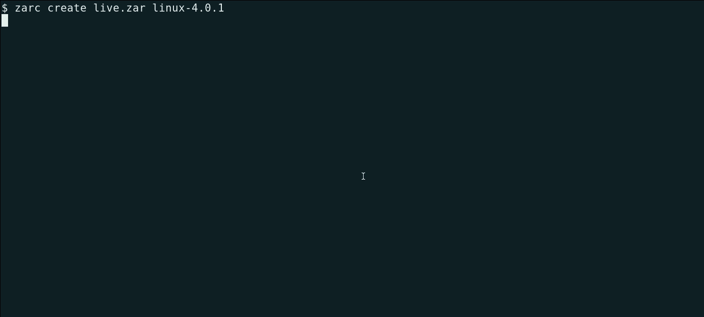
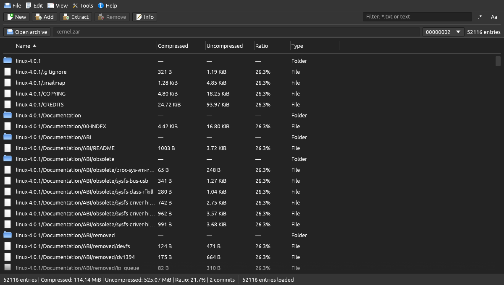

# ZAR

ZAR is an archive format and toolkit with compression, deduplication, and
commit-based history. It is written in Rust and includes a command-line tool,
a desktop GUI, a reusable library, language bindings, and a network copy tool.

See the [changelog](./CHANGELOG.md) for recent project updates. See
[CONTRIBUTING.md](./CONTRIBUTING.md) for development setup, checks, and pull
request guidance.

- **[`zarc`](./zarc/README.md)** is the command-line application.
- **[`zarg`](./zarg/README.md)** is the egui desktop archive manager.
- **[`zarlib`](./doc/zarlib-developer-guide.md)** is the reusable archive
  format and operations library.
- **[`zcopy`](./zcopy/README.md)** copies file trees between machines over the
  network using compressed, optionally encrypted ZAR batches. It can update
  missing or newer files on the destination or save a complete packed archive.
- **[`zarmcp`](./zarmcp/README.md)** provides local MCP tools for AI clients to
  inspect, read, and manage archives, with read-only and tool-allowlist modes.

## Choose your path

- **New users:** [install](#installers-and-packages), then follow the
  [quick start](#quick-start) to create, inspect, update, restore, and verify an
  archive. Prefer a desktop interface? See the [zarg guide](./zarg/README.md).
- **Developers:** start with the [Rust API quick start](#rust-api-quick-start),
  then explore the [bindings](#language-bindings-and-runtime-packages),
  [operation examples](./doc/zarlib-developer-guide.md#examples-matching-the-zarc-commands),
  and API documentation. For AI clients, see the [MCP server](./zarmcp/README.md).
- **Format implementers:** see the [format implementer path](#format-implementer-path)
  for framing, versioning, integrity, encryption, and compatibility.
- **Operators:** use the [backup and restore guidance](#backup-and-restore-operations),
  check [limitations](#limitations), and consult [troubleshooting](#troubleshooting).

## See ZAR in action

This recording uses a release build of `zarc` to archive the 525 MiB Linux
4.0.1 source tree, add an edited Makefile as a second commit, inspect the
history, and extract the original Makefile from the first commit. The final
`cmp` verifies it against the original. The displayed timings are from this
one run and depend on the machine, storage, and cache state.



The release build of `zarg` can browse the same archive and select a commit:



## What makes ZAR different

| Feature | ZAR | zip | tar.gz | 7z |
|---|---|---|---|---|
| Fast parallel compression (zstd, block based) | ✅ | ❌ (deflate) | ❌ (single-threaded gzip) | ❌ (slow LZMA) |
| Random access to a single file | ✅ | ✅ | ❌ (stream must be read) | ⚠️ solid blocks |
| Commit-based updates and compaction | ✅ | ⚠️ append only | ❌ | ❌ |
| History retained until explicitly compacted or removed | ✅ | ❌ | ❌ | ❌ |
| Content deduplication (within one create/add) | ✅ | ❌ | ❌ | ⚠️ solid only |
| Modern authenticated encryption (AES-256-GCM / ChaCha20-Poly1305, Argon2id) | ✅ | ⚠️ weak ZipCrypto or AES | ❌ needs wrapper | ✅ AES-CBC |
| Encrypt data only, header only, or both; per-commit passwords | ✅ | ❌ | ❌ | ⚠️ |
| Per-block checksums and damage recovery (`check --recover`) | ✅ | ⚠️ CRC | ❌ | ⚠️ |
| Safe extraction (no path traversal, no-follow on Unix) | ✅ | varies | varies | varies |
| Library integrations: Python, C, C++, Go, Java, C#, WASI | ✅ | varies | ❌ | varies |

Highlights:

- **Speed.** Data is split into blocks compressed in parallel with Zstandard.
  In one [Linux Core i7 benchmark](./doc/benchmarks/benchmark-report-linux-x86_64-core-i7.md)
  of the 525 MiB Linux 4.0.1 source tree, hot-cache unencrypted ZAR creation
  took 0.86 s and full extraction took 0.88–1.10 s. The same run produced a
  smaller 7z archive, but 7z creation took 24.91–24.94 s. Results depend on
  hardware, data, settings, and cache state. See
  [how to run benchmarks](./doc/benchmarks/README.md#running-benchmarks) and
  the [benchmark overview](./doc/benchmarks/README.md) for reports and charts.
  The [archive benchmark workflow](./.github/workflows/benchmark-archives.yml)
  runs on Windows, Linux, and macOS; each run uploads its generated report and
  chart from the `doc/benchmarks/` folder as workflow artifacts.
- **ZIP, 7z, RAR, ISO, TAR, and gzip extraction/import.** Pass a `.zip`, `.7z`, `.rar`, `.iso`, `.tar`,
  `.tar.gz`, `.tgz`, or standalone `.gz` file to `zarc extract` to write its
  contents directly; regular files are written in parallel. Standalone gzip
  extraction removes the `.gz` suffix from the output filename. These formats
  can also be passed to create or add, where their contents are imported under
  their paths in the new ZAR commit. This works through `zarlib`, `zarc`,
  `zarg`, and the language bindings. Encrypted ZIP/7z/RAR archives and
  ZIP/7z/RAR links are not supported. Multi-volume RAR archives and RAR
  special entries are rejected. ISO images use their ISO 9660 filesystem
  (Rock Ridge preferred, then Joliet, then primary); ISO links and special entries
  are rejected, and UDF-only images are not supported. ISO import is limited
  to 100,000 entries, 16 MiB of directory metadata, and 64 directory levels.
  TAR symbolic links are preserved where the host supports
  them; hard links are imported as regular files. TAR paths with harmless `.`
  components are normalized; parent traversal and special entries are rejected.
  Source archive timestamps are not retained; timestamp options record the
  staged files' import-time filesystem timestamps instead. 7z entries using COPY, LZMA/LZMA2, BZip2, PPMD,
  DEFLATE, Brotli, LZ4, or Zstandard are supported.
- **Batch archive conversion.** `zarc convert FOLDER` converts supported
  archive files directly inside a folder into separate `.zar` files, with an
  optional fnmatch filename filter and a separate output folder.
- **Commit-based history.** `add` records new versions, while `remove` records
  tombstones. Historical states remain available until commits are removed or
  compacted with `join`. Mutations stage a replacement archive; joining can
  rewrite compressed data.
- **Security by design.** Authenticated encryption with flexible scope,
  commit-specific passwords, bounded KDF parameters, strict canonical UTF-8
  archive paths, and extraction that cannot escape the destination.
- **Integrity.** Every frame is checksummed, `check` verifies the entire
  archive, and recovery scans past damaged regions.
- **One core, many front ends.** CLI, GUI, seven language bindings, and a
  server-side WASI component share the same Rust implementation and behavior.
- **Network copy.** `zcopy` transfers files missing from the destination or
  newer by modification time, or sends a complete packed archive. Encryption
  is optional; without a password the connection is not authenticated.

## Archive structure and history

An archive contains a container header followed by one or more commits. Each
commit carries data blocks and a header describing its changes; offset fields
connect the commits. This simplified diagram shows their physical order:

```text
ZAR archive
┌──────────────────┐
│ Container header │
├──────────────────┤
│ Commit 1         │  data blocks + header (file additions)
├──────────────────┤
│ Commit 2         │  data blocks + header (updates or additions)
├──────────────────┤
│ Commit 3         │  header (removals)
└──────────────────┘
```

**Current contents** are the files you see when the commit changes are
applied in order through the latest commit. **Retained history** lets you
inspect or extract an earlier state, even after a later commit updates or
removes a file. **Compaction** with `join` combines a chosen contiguous range
of commits into one, keeping the state at the end of that range but discarding
the individual intermediate states within it.

### Example: a file changes over time

Run these commands in a new, empty directory. The shown commit IDs are for this
fresh archive; use `zarc info` to find the IDs in an existing archive.

```sh
printf 'draft\n' > notes.txt
printf 'obsolete\n' > old.txt
zarc create history.zar notes.txt old.txt       # commit 00000001

printf 'final\n' > notes.txt
zarc add history.zar notes.txt                  # commit 00000002
zarc remove history.zar old.txt                 # commit 00000003

zarc info history.zar                           # show all three commits
zarc list history.zar                           # current contents: notes.txt
zarc extract history.zar --to 00000001 -o before # draft and old.txt
```

| After | Current contents | What history retains |
|---|---|---|
| `create` | `notes.txt` = `draft`, plus `old.txt` | The initial state in commit 1 |
| `add` | `notes.txt` = `final`, plus `old.txt` | The draft in commit 1 and the update in commit 2 |
| `remove` | `notes.txt` = `final` | Both earlier states, including `old.txt`; removal records a deletion rather than erasing its earlier data |

`remove` changes the archive, not the original files on disk. Now compact all
three commits:

```sh
zarc join history.zar --from 00000001 --to 00000003
zarc info history.zar                           # one new joined commit
zarc list history.zar                           # still just notes.txt
```

The joined archive still contains `notes.txt` with `final`, but the original
three commit IDs and the earlier `draft` and `old.txt` states from that range
are no longer available through that archive. Joining can rewrite data and may
reduce size, but does not guarantee a smaller archive. Commits outside a joined
range remain in place. Keep a separate copy before joining if you need the
individual historical states. See the [CLI guide](./zarc/README.md#append-remove-and-compact-commits)
for command details and encrypted-archive limitations.

## Benchmarks

The [Linux Core i7 benchmark report](./doc/benchmarks/benchmark-report-linux-x86_64-core-i7.md)
measured the 525.1 MiB Linux 4.0.1 source tree on an Intel Core i7-10700
with SSD/non-rotational storage. The table shows the report's minimum–maximum
times for compression, full extraction, and extraction of three selected
files; hot-cache configurations were measured twice and cold-cache
configurations once. **Bold** marks the smallest archive or fastest observed
time (the lower end of each range) for each encryption and cache combination;
ties at the displayed precision are also marked.

| Format | Encrypted | Cache | Archive size | Compression | Full extraction | Extract 3 files |
|---|---|---|---:|---:|---:|---:|
| ZAR | No | Hot | 115.5 MiB | 0.86–0.86 s | **0.88–1.10 s** | 0.124–0.129 s |
| ZAR | Yes | Hot | 115.4 MiB | **0.96–1.00 s** | **1.21–1.22 s** | 0.345–0.354 s |
| ZIP | No | Hot | 151.1 MiB | 11.01–11.05 s | 3.84–3.90 s | **0.007–0.007 s** |
| ZIP | Yes | Hot | 152.4 MiB | 11.52–11.59 s | 4.96–4.97 s | **0.012–0.012 s** |
| 7z | No | Hot | **81.1 MiB** | 24.91–24.94 s | 5.68–5.70 s | 3.407–3.434 s |
| 7z | Yes | Hot | **81.1 MiB** | 24.80–24.93 s | 5.83–5.86 s | 3.553–3.583 s |
| tar | No | Hot | 562.7 MiB | **0.52–0.53 s** | 0.91–1.00 s | 0.063–0.065 s |
| tar | Yes | Hot | 562.7 MiB | 2.02–2.69 s | 2.07–2.49 s | 1.360–1.366 s |
| tar.gz | No | Hot | 122.1 MiB | 12.76–12.79 s | 2.24–2.26 s | 2.170–2.222 s |
| tar.gz | Yes | Hot | 122.1 MiB | 12.98–13.21 s | 2.49–2.96 s | 2.473–2.483 s |
| ZAR | No | Cold | 115.4 MiB | **1.03–1.03 s** | 1.13–1.13 s | 0.161–0.161 s |
| ZAR | Yes | Cold | 115.4 MiB | **1.10–1.10 s** | **1.33–1.33 s** | 0.401–0.401 s |
| ZIP | No | Cold | 151.1 MiB | 17.47–17.47 s | 4.13–4.13 s | **0.020–0.020 s** |
| ZIP | Yes | Cold | 152.4 MiB | 17.81–17.81 s | 5.19–5.19 s | **0.021–0.021 s** |
| 7z | No | Cold | **81.1 MiB** | 26.75–26.75 s | 5.78–5.78 s | 3.519–3.519 s |
| 7z | Yes | Cold | **81.1 MiB** | 27.00–27.00 s | 5.83–5.83 s | 3.587–3.587 s |
| tar | No | Cold | 562.7 MiB | 7.05–7.05 s | **1.10–1.10 s** | 0.870–0.870 s |
| tar | Yes | Cold | 562.7 MiB | 9.19–9.19 s | 3.25–3.25 s | 2.383–2.383 s |
| tar.gz | No | Cold | 122.1 MiB | 13.63–13.63 s | 2.47–2.47 s | 2.292–2.292 s |
| tar.gz | Yes | Cold | 122.1 MiB | 14.09–14.09 s | 3.44–3.44 s | 3.187–3.187 s |

Tar is an uncompressed baseline. Encryption methods differ: the ZIP test uses
legacy ZipCrypto, while tar and tar.gz use an OpenSSL encryption wrapper.
Results depend on the hardware, data, settings, and cache state; see the
[full report](./doc/benchmarks/benchmark-report-linux-x86_64-core-i7.md) for
throughput, verification limitations, tool settings, and methodology.

## Limitations

- `zarc extract` restores symlinks and devices only when explicitly requested.
  Device creation may require privileges, and symlink targets must remain
  within the extraction root.
- `create` and `add` can record entry modification times with
  `--modification-time` (`--mt`), creation times with `--creation-time`
  (`--ct`), and access times with `--access-time` (`--at`). Creation- or
  access-time recording fails if a stored entry's filesystem does not provide
  it. Access times can change as files or directories are read and depend on
  filesystem policies. Archive extraction does not restore these timestamps. `zcopy` transfers and
  restores file modification times separately in its unpack mode.
- Only logical-header version 8 is supported. Archives created by unreleased
  versions that used logical-header versions 0–7 cannot be interpreted by
  current readers; all new commits use version 8.
  The unreleased version 8 entry-metadata layout has changed: archives written
  with its earlier layout may not be readable when they contain entry metadata.
- `zarc add` can use passwords for existing encrypted commits. The CLI
  `remove` and `join` commands do not accept those passwords: `remove` cannot
  operate when encrypted commits need passwords, and `join` skips locked
  commits rather than including them. Password-aware Rust library operations
  support removal and joining with credentials, subject to their own validation
  rules.
- Listing and extraction without passwords can omit commits with locked
  headers, producing a partial view. A visible data-encrypted commit still
  requires its password for extraction. Use passwords for all relevant
  commits when a complete result is required.
- `zcopy` is a one-way copy, not a mirror: it does not propagate deletions
  and compares whole-second modification times rather than file contents.
  See its [README](./zcopy/README.md) for cache and concurrency details.
- Compression ratio depends on data and settings. Some 7z configurations
  produce smaller archives in the provided benchmarks.

## Language bindings and runtime packages

`zarlib` is available through language bindings and a WASI component. They
expose archive operations through their respective language or runtime
interfaces; see each package's documentation for its API and limitations.

| Package | Language/runtime | Mechanism |
|---------|----------|-----------|
| **[`pyzarlib`](./pyzarlib/README.md)** | Python | PyO3 extension module |
| **[`czarlib`](./czarlib/README.md)** | C | JSON C ABI (shared/static library and header) |
| **[`cxxzarlib`](./cxxzarlib/README.md)** | C++ | CXX bridge |
| **[`gozarlib`](./gozarlib/README.md)** | Go | cgo over `czarlib` |
| **[`jzarlib-ffm`](./jzarlib-ffm/README.md)** | Java 25+ | Foreign Function & Memory API over `czarlib` |
| **[`jzarlib-jni`](./jzarlib-jni/README.md)** | Java | JNI shim over `czarlib` |
| **[`csharpzarlib`](./csharpzarlib/README.md)** | C# (.NET 10) | P/Invoke over `czarlib` |
| **[`wasizarlib`](./wasizarlib/README.md)** | WebAssembly / Node.js | WASI Preview 2 component with a WIT interface; Node support via Jco and the Preview 2 shim |

The Go, Java, and C# wrappers load the `czarlib` shared library, which is built
with `cargo build -p czarlib`.

The WASI component is built for `wasm32-wasip2`; its filesystem access is
limited to directories preopened by the server-side WASI runtime. Node.js
applications can run it through Jco and the Preview 2 shim; Node's built-in
`node:wasi` API is Preview 1 and does not directly run this component.

The archive format stores data in commits. Commits support compressed and
deduplicated data blocks, an ordered logical table of contents (TOC), integrity
checks, and optional password-based encryption. See the
[format description](./doc/zar-file-format.md) for details.

## Build

Install a Rust toolchain that supports the 2024 edition, then build or test the
workspace from the repository root:

```sh
cargo build --workspace --release
cargo test --workspace
```

Run the CLI directly from the workspace:

```sh
cargo run --release -p zarc -- --help
cargo run --release -p zarg
cargo run --release -p zcopy -- --help
```

For MCP clients, build `zarmcp` with `cargo build --release -p zarmcp` and
follow the [server configuration and security guidance](./zarmcp/README.md).

Build the server-side WASI component separately:

```sh
rustup target add wasm32-wasip2
cargo build --release -p wasizarlib --target wasm32-wasip2
```

Or install the executable into Cargo's binary directory:

```sh
cargo install --path zarc
```

## Installers and packages

The [packaging](./packaging) directory contains installer definitions for the
`zarc` CLI and the `zarg` GUI:

- **Windows:** an [Inno Setup](https://jrsoftware.org/isinfo.php) script
  (`packaging/windows/zar-rs.iss`) that can also add `zarc` to the `PATH`.
- **Linux:** `packaging/linux/build-packages.sh [deb|rpm|appimage|flatpak|all]`
  builds `.deb`, `.rpm`, AppImage and Flatpak packages into `dist/`.
- **macOS:** `packaging/macos/build-packages.sh [dmg|pkg|all]` builds a `.dmg`
  with `Zarg.app` and a `.pkg` that also installs `zarc`.

```sh
iscc /DAppVersion=0.9.0 packaging\windows\zar-rs.iss   # Windows
packaging/linux/build-packages.sh deb                  # Linux
```

See [packaging/README.md](./packaging/README.md) for prerequisites and options.

## Quick start

Install `zarc` using an [installer or package](#installers-and-packages), or
run `cargo install --path zarc` from a local checkout. The commands below use
an unencrypted archive and existing input paths relative to your working
directory; start with no `backup.zar` in that directory.

```sh
# Create an archive from files and directories
zarc create backup.zar documents/ src/ notes.txt

# Inspect the archive and list its current contents
zarc info -v backup.zar
zarc list backup.zar

# After changing files, append their new versions
zarc add backup.zar documents/

# Verify the archive, then restore its current contents
zarc check backup.zar
zarc extract backup.zar --output ./restored/

# Inspect and restore the initial state (commit ID from zarc info)
zarc list backup.zar --to 00000001
zarc extract backup.zar --to 00000001 --output ./restored-initial/
```

`add` updates the paths supplied to it; it does not automatically remove paths
deleted from disk. Use `zarc remove` for archive paths you want to delete.
`info` shows the actual commit IDs; the first commit in this fresh example is
`00000001`. Use `zarc <command> --help` for options and the
[CLI guide](./zarc/README.md) for encryption, conversion, and other workflows.

## Rust API quick start

For a Rust project alongside this checkout's `zarlib` directory, add a path
dependency (adjust the path to your checkout):

```toml
[dependencies]
zarlib = { path = "../zarlib" }
```

For example, create and check an unencrypted archive, propagating errors:

```rust,no_run
use std::path::PathBuf;
use zarlib::operations::{check_archive_with_recovery, create_archive};

fn main() -> Result<(), Box<dyn std::error::Error>> {
    create_archive("backup.zar", &[PathBuf::from("documents")])?;
    let report = check_archive_with_recovery("backup.zar", false, None)?;
    println!("Verified {} commits", report.commits);
    Ok(())
}
```

The input must exist and `backup.zar` must not already exist. See the
[developer guide](./doc/zarlib-developer-guide.md#high-level-api) for listing,
extraction, and [more examples](./doc/zarlib-developer-guide.md#examples-matching-the-zarc-commands),
or use the [language bindings](#language-bindings-and-runtime-packages).
For Rust API documentation, run `cargo doc -p zarlib --no-deps --open` from the
workspace root.

## Format implementer path

The [file architecture](./doc/zar-file-format.md) describes the
[container and commit layout](./doc/zar-file-format.md#physical-layout),
[header frame and logical-header versioning](./doc/zar-file-format.md#header-frame),
and [data block frames](./doc/zar-file-format.md#data-block-frame), including
xxHash64 checksums. Checksums detect corruption, not malicious modification;
encrypted payloads also require AEAD authentication. The
[encryption reference](./doc/zarlib-developer-guide.md#encryption-and-operation-constraints)
explains algorithms, scopes, and per-commit passwords. For the actual encoding
and validation behavior, follow the linked implementation files in the format
document and the [framing APIs](./doc/zarlib-developer-guide.md#framing-and-validation-apis).

Only logical-header version 8 is supported; versions 0–7 are rejected when
decoded. Earlier unreleased version 8 archives with entry metadata may also be
incompatible because that layout changed. Locked headers cannot be
version-checked until decrypted. See [limitations](#limitations) and the
[header format](./doc/zar-file-format.md#header-frame) for details.

## Backup and restore operations

1. Archive a consistent source snapshot where possible. Review warnings and
   nonzero exit statuses: unreadable or unsupported inputs can be skipped, so
   an archive is not necessarily a complete backup of the source tree.
2. Run `zarc check backup.zar` after creation and updates. For encrypted
   archives, supply the relevant passwords, such as with `--password`; locked
   content cannot be fully verified without them.
3. Keep independent backup copies and protect the passwords separately. Before
   `join`, `remove-commits`, or `create --overwrite`, retain a separate copy
   if the existing history is needed.
4. Periodically restore to a separate directory and compare the results with
   the intended source, including metadata important to your use case.
   `zarc extract backup.zar --dry-run` previews the extraction; `--to ID`
   selects an earlier commit. Read the [limitations](#limitations) before
   relying on timestamp, symlink, device, or encrypted-history restoration.

For off-machine transfer, see the [zcopy guide](./zcopy/README.md); unpack
mode is a one-way update, not a deletion-propagating mirror.

### Troubleshooting

- **Files are missing from a backup or restore:** inspect the command warnings
  and filters, run `zarc list backup.zar`, and check whether encrypted headers
  need passwords. A passwordless view can be partial.
- **Verification reports damage:** preserve the original and other backup
  copies. `zarc check --recover backup.zar` scans past damaged framing and
  reports gaps; it does not repair the archive or establish that a recovered
  view is complete.
- **Restore encounters existing files or unexpected metadata:** use a separate
  destination, review `zarc extract --help`, and see the
  [extraction options](./zarc/README.md#extract-files) and
  [limitations](#limitations).
- **A command fails or reports warnings:** inspect its diagnostics and nonzero
  exit status; see [CLI exit behavior](./zarc/README.md#exit-behavior). For
  encrypted archives, also confirm the correct passwords and operation
  restrictions.

## Format and safety notes

- The `.zar` format uses a `ZAR0` container header and ordered commits. Each
  commit stores data blocks followed by its header frame.
- Frame checksums detect accidental corruption; they are not authentication.
  Encrypted frames use authenticated encryption.
- `zarc check` verifies readable framing, checksums, and logical state. Without
  the password, encrypted payloads cannot be authenticated or decrypted and
  headers encrypted by password cannot be interpreted.
- `zarc extract` does not restore symlinks or device nodes unless their
  corresponding options are enabled. Symlink targets are restricted to the
  extraction root. Unix extraction uses no-follow directory-relative file
  operations; the non-Unix fallback does not provide equivalent resistance to
  path races.
- `zarc add` accepts passwords for existing encrypted commits; `remove` and
  `join` do not. `join` operates on readable commits and leaves locked commits
  unchanged; some histories cannot be joined without unlocking a preceding
  header. The password-aware Rust library API provides more options.
- `zarc check --recover` scans past damaged framing without modifying the
  archive. It reports recovered gaps as warnings; logical state is restarted
  after each gap.

## Important notes to binaries in release

All binaries and libraries for X86-64 CPUs are built with `target-cpu=x86-64-v3`,
which means that these binaries and libraries won't run on CPUs before 2013!
If you have a CPU which does not have AVX2 support then you must compile these
binaries and libraries yourself.

```sh
RUSTFLAGS="-C target-cpu=native" cargo build --release --bins
```

## License

This workspace is licensed under either of the licenses listed in the
workspace manifests: [MIT](./LICENSE-MIT) or [Apache-2.0](./LICENSE-APACHE).

## Notes to AI use

This project is a refactoring of another, fully hand written project. The whole
refactoring with several improvments in code and documentation were done with
AI.
