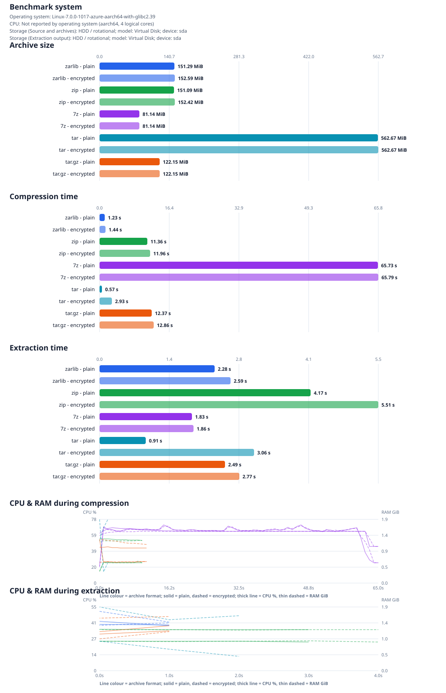

# Linux 4.0.1 Archive Benchmark

Run date: 2026-10-31T17:16:32+00:00  
- Operating system: Linux-7.0.0-1017-azure-aarch64-with-glibc2.39
- CPU: Not reported by operating system (aarch64, 4 logical cores)
- Benchmark storage (Source and archives): HDD / rotational; model: Virtual Disk; device: sda
- Benchmark storage (Extraction output): HDD / rotational; model: Virtual Disk; device: sda

## Results

Source: [`linux-4.0.1.tar.gz`](https://cdn.kernel.org/pub/linux/kernel/v4.x/linux-4.0.1.tar.gz)  
Uncompressed source size: 525.1 MiB  
Regular files verified: 48,945  
Symbolic links excluded from path/size verification: 12

| Format | Encryption | Cache | Archive size | Compression | Extraction | CPU / RAM (compress) | CPU / RAM (extract) |
|---|---:|---:|---:|---:|---:|---:|---:|
| zarlib | No | hot | 151.3 MiB | 1.23 s (425.4 MiB/s) | 2.28 s (230.6 MiB/s) | 0 % / 1.4 GiB | 41 % / 1.4 GiB |
| zarlib | Yes | hot | 152.6 MiB | 1.44 s (363.6 MiB/s) | 2.59 s (202.6 MiB/s) | 0 % / 1.3 GiB | 46 % / 1.4 GiB |
| zip | No | hot | 151.1 MiB | 11.36 s (46.2 MiB/s) | 4.17 s (125.9 MiB/s) | 24 % / 1.3 GiB | 25 % / 1.2 GiB |
| zip | Yes | hot | 152.4 MiB | 11.96 s (43.9 MiB/s) | 5.51 s (95.3 MiB/s) | 24 % / 1.2 GiB | 25 % / 1.2 GiB |
| 7z | No | hot | 81.1 MiB | 65.73 s (8.0 MiB/s) | 1.83 s (287.3 MiB/s) | 63 % / 1.5 GiB | 55 % / 1.3 GiB |
| 7z | Yes | hot | 81.1 MiB | 65.79 s (8.0 MiB/s) | 1.86 s (282.5 MiB/s) | 63 % / 1.5 GiB | 52 % / 1.3 GiB |
| tar | No | hot | 562.7 MiB | 0.57 s (914.1 MiB/s) | 0.91 s (574.6 MiB/s) | 0 % / 0.0 GiB | 0 % / 0.0 GiB |
| tar | Yes | hot | 562.7 MiB | 2.93 s (179.3 MiB/s) | 3.06 s (171.7 MiB/s) | 39 % / 1.6 GiB | 19 % / 1.7 GiB |
| tar.gz | No | hot | 122.2 MiB | 12.37 s (42.4 MiB/s) | 2.49 s (211.2 MiB/s) | 29 % / 1.0 GiB | 33 % / 1.3 GiB |
| tar.gz | Yes | hot | 122.2 MiB | 12.86 s (40.8 MiB/s) | 2.77 s (189.9 MiB/s) | 26 % / 1.2 GiB | 30 % / 1.6 GiB |

Throughput uses the uncompressed regular-file size. Each extraction was run into
a freshly emptied `testresults/` directory, then checked against the source tree
for matching regular-file paths and sizes. During its 2 extraction run(s), `zarlib` renamed 24 path(s) total (12 per run) due to case-folded collisions; generated suffixes are normalized only for comparison. The results
directory was emptied again after each check. Symlink entries are excluded
because `zarlib` currently reports and skips unsupported input symlinks. ZIP
and tar preserve links; 7z preserves them in its archive but may skip unsafe
relative links during extraction, as noted above.

CPU utilisation and RAM consumption were sampled at 1-second intervals during
each compression and extraction operation using `psutil`. The table shows the
average CPU % and RAM GiB across all samples for each phase. The time-series
charts below the bar charts plot every sample, with one line per archive format
(solid = plain, dashed = encrypted; thick line = CPU %, thin dashed line = RAM GiB).
The CPU model and operating system are collected from the host. Storage details
describe the volumes holding the source/archive files and extraction output.
The operating system may not expose physical media behind virtual or layered
storage; such cases are identified as unknown or non-rotational/possibly virtual.

## Method

- **Cache state**: `hot` runs read every file of the source tree (and, before
  extraction, the archive) once before the measured operation. `cold` runs drop
  the operating system file cache before every measured operation: `sync` plus
  writing `3` to `/proc/sys/vm/drop_caches` on Linux (root required), or
  `RAMMap.exe -Et` on Windows (elevation required). Cold runs are skipped with
  a warning when the privileges are missing.

- `zarlib`: `zarc` release build, default Zstandard compression level 3;
  encrypted runs use AES-256-GCM and the default header-and-data scope.
- `zip`: Info-ZIP recursive DEFLATE at level 6, storing symlinks as links.
  Encrypted runs use the implementation's standard ZipCrypto mode
  (legacy/weak encryption).
- `7z`: 7z format with LZMA2 at level 5. Encrypted runs use AES-256 and
  encrypted headers; symlinks are stored as links. The 7-Zip CLI accepts
  passwords only as a command-line switch; this runner generates a temporary
  random password and never saves it. During extraction, 7-Zip rejects
  relative symlink targets containing parent components; the runner
  accepts only the expected warnings for those source links and still
  verifies every regular file.
- `tar`: GNU tar without compression (a pure archiving baseline). The
  encrypted run times tar plus OpenSSL CMS AES-256-GCM encryption and is
  decrypted before extraction, like `tar.gz`.
- `tar.gz`: GNU tar with gzip's default compression level. Since tar.gz has no
  built-in encryption, the encrypted run times tar/gzip plus OpenSSL CMS
  AES-256-GCM encryption. It is decrypted before extraction. A temporary
  self-signed RSA certificate is used to wrap the CMS content key; the
  temporary private key is deleted when the benchmark exits.
- Compression and extraction are each measured once per format/configuration.
  Build time, source download/extraction, and post-extraction verification are
  excluded from the measured operation times.

## Tool versions

- `cargo`: `cargo 1.99.1 (5f94df478 2026-08-27)`
- `tar`: `tar (GNU tar) 1.35`
- `openssl`: `OpenSSL 3.0.13 30 Jan 2024 (Library: OpenSSL 3.0.13 30 Jan 2024)`
- `7z`: `7-Zip 23.01 (arm64) : Copyright (c) 1999-2023 Igor Pavlov : 2023-06-20`
- `zip`: `This is Zip 3.0 (July 5th 2008), by Info-ZIP.`
- `unzip`: `UnZip 6.00 of 20 April 2009, by Debian. Original by Info-ZIP.`

The generated archives and temporary key material are removed after the run.
The source archive and extracted source tree remain in `testdata/`.
