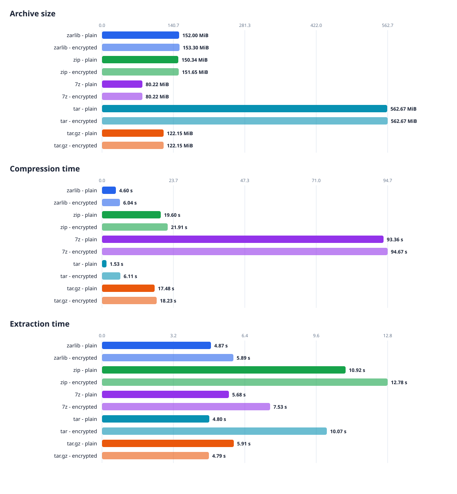

# Linux 4.0.1 Archive Benchmark

Run date: 2026-10-30T18:17:01+01:00  
Operating system: Linux-7.2.6-070206-generic-x86_64-with-glibc2.43  
CPU: x86_64, 8 logical cores

## Results

Source: [`linux-4.0.1.tar.gz`](https://cdn.kernel.org/pub/linux/kernel/v4.x/linux-4.0.1.tar.gz)  
Uncompressed source size: 525.1 MiB  
Regular files verified: 48,945  
Symbolic links excluded from path/size verification: 12

| Format | Encryption | Cache | Archive size | Compression | Extraction |
|---|---:|---:|---:|---:|---:|
| zarlib | No | hot | 152.0 MiB | 4.42 s (118.8 MiB/s) | 5.01 s (104.8 MiB/s) |
| zarlib | Yes | hot | 153.3 MiB | 6.32 s (83.0 MiB/s) | 6.48 s (81.0 MiB/s) |
| zip | No | hot | 151.1 MiB | 20.23 s (26.0 MiB/s) | 14.70 s (35.7 MiB/s) |
| zip | Yes | hot | 152.4 MiB | 18.85 s (27.9 MiB/s) | 12.05 s (43.6 MiB/s) |
| 7z | No | hot | 80.2 MiB | 74.13 s (7.1 MiB/s) | 6.69 s (78.5 MiB/s) |
| 7z | Yes | hot | 80.2 MiB | 69.64 s (7.5 MiB/s) | 5.67 s (92.6 MiB/s) |
| tar | No | hot | 562.7 MiB | 1.40 s (376.4 MiB/s) | 2.29 s (229.2 MiB/s) |
| tar | Yes | hot | 562.7 MiB | 6.76 s (77.7 MiB/s) | 16.83 s (31.2 MiB/s) |
| tar.gz | No | hot | 122.1 MiB | 15.54 s (33.8 MiB/s) | 2.72 s (192.9 MiB/s) |
| tar.gz | Yes | hot | 122.1 MiB | 16.05 s (32.7 MiB/s) | 3.23 s (162.6 MiB/s) |
| zarlib | No | cold | 152.0 MiB | 4.18 s (125.6 MiB/s) | 4.38 s (119.9 MiB/s) |
| zarlib | Yes | cold | 153.3 MiB | 4.93 s (106.5 MiB/s) | 5.41 s (97.0 MiB/s) |
| zip | No | cold | 151.1 MiB | 24.33 s (21.6 MiB/s) | 8.92 s (58.8 MiB/s) |
| zip | Yes | cold | 152.4 MiB | 25.42 s (20.7 MiB/s) | 12.73 s (41.2 MiB/s) |
| 7z | No | cold | 80.2 MiB | 74.86 s (7.0 MiB/s) | 5.07 s (103.6 MiB/s) |
| 7z | Yes | cold | 80.2 MiB | 72.86 s (7.2 MiB/s) | 5.99 s (87.6 MiB/s) |
| tar | No | cold | 562.7 MiB | 7.87 s (66.8 MiB/s) | 2.37 s (221.5 MiB/s) |
| tar | Yes | cold | 562.7 MiB | 23.06 s (22.8 MiB/s) | 17.99 s (29.2 MiB/s) |
| tar.gz | No | cold | 122.1 MiB | 16.18 s (32.4 MiB/s) | 3.33 s (157.7 MiB/s) |
| tar.gz | Yes | cold | 122.1 MiB | 19.89 s (26.4 MiB/s) | 6.57 s (79.9 MiB/s) |

Throughput uses the uncompressed regular-file size. Each extraction was run into
a freshly emptied `testresults/` directory, then checked against the source tree
for matching regular-file paths and sizes. During its 4 extraction run(s), `zarlib` renamed 48 path(s) total (12 per run) due to case-folded collisions; generated suffixes are normalized only for comparison. The results
directory was emptied again after each check. Symlink entries are excluded
because `zarlib` currently reports and skips unsupported input symlinks. ZIP
and tar preserve links; 7z preserves them in its archive but may skip unsafe
relative links during extraction, as noted above.

## Method

- **Cache state**: `hot` runs read every file of the source tree (and, before
  extraction, the archive) once before the measured operation. `cold` runs drop
  the operating system file cache before every measured operation: `sync` plus
  writing `3` to `/proc/sys/vm/drop_caches` on Linux (root required), or
  `RAMMap.exe -Et` on Windows (elevation required). Cold runs are skipped with
  a warning when the privileges are missing.

- `zarlib`: `zarc` release build, default Zstandard compression level 3;
  encrypted runs use AES-256-GCM and the default header-and-data scope.
- `zip`: Info-ZIP recursive DEFLATE at level 6, storing symlinks as links.
  Encrypted runs use the implementation's standard ZipCrypto mode
  (legacy/weak encryption).
- `7z`: 7z format with LZMA2 at level 5. Encrypted runs use AES-256 and
  encrypted headers; symlinks are stored as links. The 7-Zip CLI accepts
  passwords only as a command-line switch; this runner generates a temporary
  random password and never saves it. During extraction, 7-Zip rejects
  relative symlink targets containing parent components; the runner
  accepts only the expected warnings for those source links and still
  verifies every regular file.
- `tar`: GNU tar without compression (a pure archiving baseline). The
  encrypted run times tar plus OpenSSL CMS AES-256-GCM encryption and is
  decrypted before extraction, like `tar.gz`.
- `tar.gz`: GNU tar with gzip's default compression level. Since tar.gz has no
  built-in encryption, the encrypted run times tar/gzip plus OpenSSL CMS
  AES-256-GCM encryption. It is decrypted before extraction. A temporary
  self-signed RSA certificate is used to wrap the CMS content key; the
  temporary private key is deleted when the benchmark exits.
- Compression and extraction are each measured once per format/configuration.
  Build time, source download/extraction, and post-extraction verification are
  excluded from the measured operation times.

## Tool versions

- `cargo`: `cargo 1.99.1 (5f94df478 2026-08-27)`
- `tar`: `tar (GNU tar) 1.35`
- `openssl`: `OpenSSL 3.5.5 27 Jan 2026 (Library: OpenSSL 3.5.5 27 Jan 2026)`
- `7z`: `7-Zip 26.00 (x64) : Copyright (c) 1999-2026 Igor Pavlov : 2026-02-12`
- `zip`: `This is Zip 3.0 (July 5th 2008), by Info-ZIP.`
- `unzip`: `UnZip 6.00 of 20 April 2009, by Debian. Original by Info-ZIP.`

The generated archives and temporary key material are removed after the run.
The source archive and extracted source tree remain in `testdata/`.
