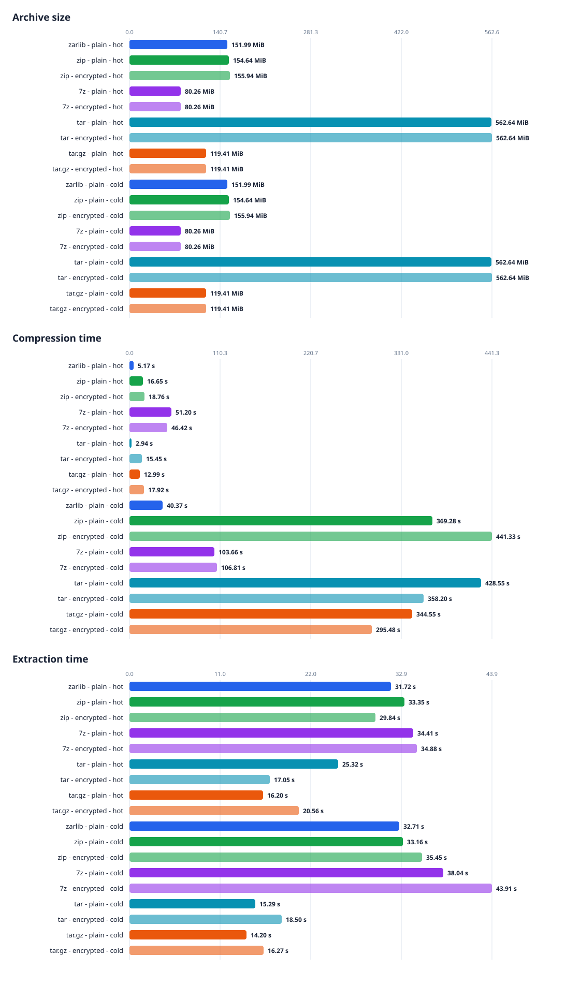

# Linux 4.0.1 Archive Benchmark

Run date: 2026-10-30T15:15:08+01:00  
Operating system: Windows-11-10.0.26200-SP0  
CPU: AMD64, 20 logical cores

## Results

Source: [`linux-4.0.1.tar.gz`](https://cdn.kernel.org/pub/linux/kernel/v4.x/linux-4.0.1.tar.gz)  
Uncompressed source size: 525.0 MiB  
Regular files verified: 48,933  
Symbolic links excluded from path/size verification: 12

| Format | Encryption | Cache | Archive size | Compression | Extraction |
|---|---:|---:|---:|---:|---:|
| zarlib | No | hot | 152.0 MiB | 5.17 s (101.6 MiB/s) | 31.72 s (16.6 MiB/s) |
| zip | No | hot | 154.6 MiB | 16.65 s (31.5 MiB/s) | 33.35 s (15.7 MiB/s) |
| zip | Yes | hot | 155.9 MiB | 18.76 s (28.0 MiB/s) | 29.84 s (17.6 MiB/s) |
| 7z | No | hot | 80.3 MiB | 51.20 s (10.3 MiB/s) | 34.41 s (15.3 MiB/s) |
| 7z | Yes | hot | 80.3 MiB | 46.42 s (11.3 MiB/s) | 34.88 s (15.1 MiB/s) |
| tar | No | hot | 562.6 MiB | 2.94 s (178.7 MiB/s) | 25.32 s (20.7 MiB/s) |
| tar | Yes | hot | 562.6 MiB | 15.45 s (34.0 MiB/s) | 17.05 s (30.8 MiB/s) |
| tar.gz | No | hot | 119.4 MiB | 12.99 s (40.4 MiB/s) | 16.20 s (32.4 MiB/s) |
| tar.gz | Yes | hot | 119.4 MiB | 17.92 s (29.3 MiB/s) | 20.56 s (25.5 MiB/s) |
| zarlib | No | cold | 152.0 MiB | 40.37 s (13.0 MiB/s) | 32.71 s (16.1 MiB/s) |
| zip | No | cold | 154.6 MiB | 369.28 s (1.4 MiB/s) | 33.16 s (15.8 MiB/s) |
| zip | Yes | cold | 155.9 MiB | 441.33 s (1.2 MiB/s) | 35.45 s (14.8 MiB/s) |
| 7z | No | cold | 80.3 MiB | 103.66 s (5.1 MiB/s) | 38.04 s (13.8 MiB/s) |
| 7z | Yes | cold | 80.3 MiB | 106.81 s (4.9 MiB/s) | 43.91 s (12.0 MiB/s) |
| tar | No | cold | 562.6 MiB | 428.55 s (1.2 MiB/s) | 15.29 s (34.3 MiB/s) |
| tar | Yes | cold | 562.6 MiB | 358.20 s (1.5 MiB/s) | 18.50 s (28.4 MiB/s) |
| tar.gz | No | cold | 119.4 MiB | 344.55 s (1.5 MiB/s) | 14.20 s (37.0 MiB/s) |
| tar.gz | Yes | cold | 119.4 MiB | 295.48 s (1.8 MiB/s) | 16.27 s (32.3 MiB/s) |

Throughput uses the uncompressed regular-file size. Each extraction was run into
a freshly emptied `testresults/` directory, then checked against the source tree
for matching regular-file paths and sizes. During its 2 extraction run(s), `zarlib` renamed 0 path(s) total (0 per run) due to case-folded collisions; generated suffixes are normalized only for comparison. The results
directory was emptied again after each check. Symlink entries are excluded
because `zarlib` currently reports and skips unsupported input symlinks. ZIP
and tar preserve links; 7z preserves them in its archive but may skip unsafe
relative links during extraction, as noted above.

## Method

- **Cache state**: `hot` runs read every file of the source tree (and, before
  extraction, the archive) once before the measured operation. `cold` runs drop
  the operating system file cache before every measured operation: `sync` plus
  writing `3` to `/proc/sys/vm/drop_caches` on Linux (root required), or
  `RAMMap.exe -Et` on Windows (elevation required). Cold runs are skipped with
  a warning when the privileges are missing.
- `zarlib` encrypted runs are skipped on this platform because `zarc` can only prompt for passwords on POSIX terminals.
- On this platform `zip`/`unzip` receive the password with `-P` instead of an interactive prompt.
- `zarlib`: `zarc` release build, default Zstandard compression level 3;
  encrypted runs use AES-256-GCM and the default header-and-data scope.
- `zip`: Info-ZIP recursive DEFLATE at level 6, storing symlinks as links.
  Encrypted runs use the implementation's standard ZipCrypto mode
  (legacy/weak encryption).
- `7z`: 7z format with LZMA2 at level 5. Encrypted runs use AES-256 and
  encrypted headers; symlinks are stored as links. The 7-Zip CLI accepts
  passwords only as a command-line switch; this runner generates a temporary
  random password and never saves it. During extraction, 7-Zip rejects
  relative symlink targets containing parent components; the runner
  accepts only the expected warnings for those source links and still
  verifies every regular file.
- `tar`: GNU tar without compression (a pure archiving baseline). The
  encrypted run times tar plus OpenSSL CMS AES-256-GCM encryption and is
  decrypted before extraction, like `tar.gz`.
- `tar.gz`: GNU tar with gzip's default compression level. Since tar.gz has no
  built-in encryption, the encrypted run times tar/gzip plus OpenSSL CMS
  AES-256-GCM encryption. It is decrypted before extraction. A temporary
  self-signed RSA certificate is used to wrap the CMS content key; the
  temporary private key is deleted when the benchmark exits.
- Compression and extraction are each measured once per format/configuration.
  Build time, source download/extraction, and post-extraction verification are
  excluded from the measured operation times.

## Tool versions

- `cargo`: `cargo 1.101.0-nightly (29c5daa1a 2026-10-07)`
- `tar`: `bsdtar 3.8.9 - libarchive 3.8.9 zlib/1.2.13.1-motley liblzma/5.8.3 bz2lib/1.0.8 libzstd/1.5.7 cng/2.0 libb2/bundled`
- `openssl`: `OpenSSL 4.1.0 23 Oct 2026 (Library: OpenSSL 4.1.0 23 Oct 2026)`
- `7z`: `7-Zip 26.03 (x64) : Copyright (c) 1999-2026 Igor Pavlov : 2026-09-03`
- `zip`: `This is Zip 3.0 (July 5th 2008), by Info-ZIP.`
- `unzip`: `UnZip 6.00 of 20 April 2009, by Info-ZIP.  Maintained by C. Spieler.  Send`

The generated archives and temporary key material are removed after the run.
The source archive and extracted source tree remain in `testdata/`.
