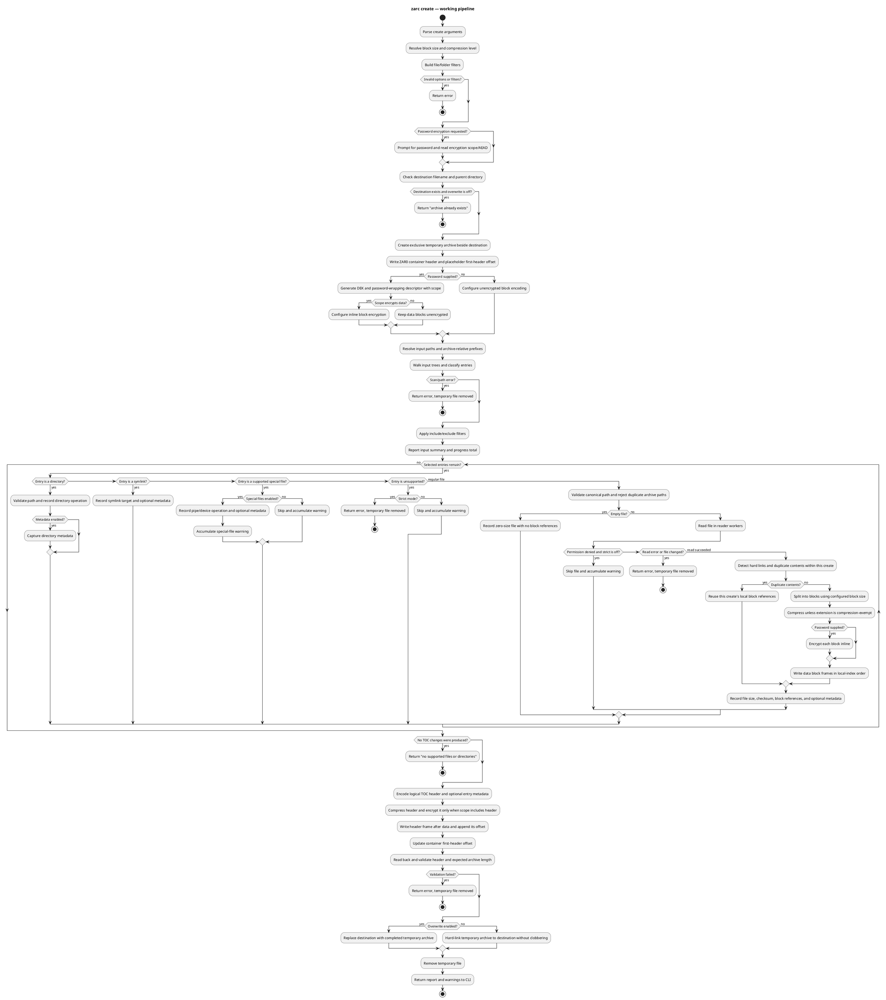
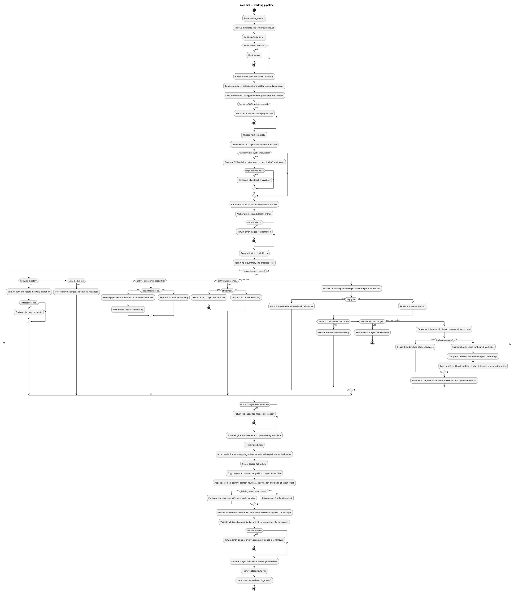
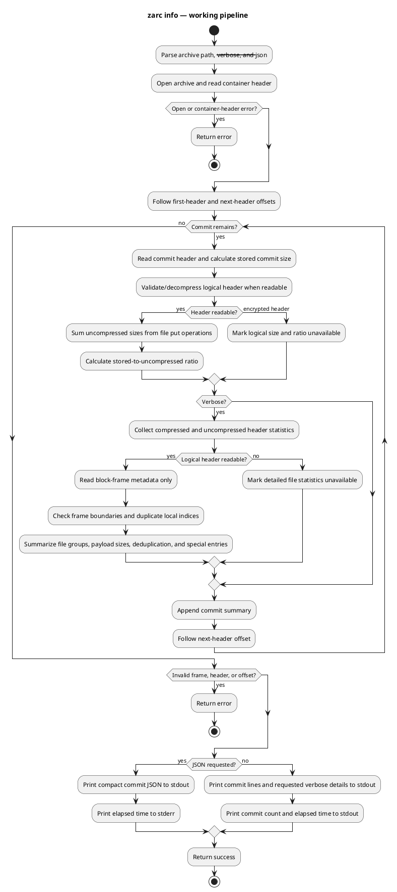

# `zarc create` and `zarc add` pipelines

These diagrams follow the current CLI and `zarlib::operations` implementations.
Both commands scan source paths into canonical archive-relative paths, apply
filters, and feed selected entries through the shared scan/encode pipeline.
They differ in archive publication and commit chaining. Either operation can
create a password-encrypted commit using AES-256-GCM or ChaCha20-Poly1305 and
the selected header/data encryption scope.

## Create

`create` writes a new one-commit archive to a unique temporary file in the
destination directory. Data block frames are streamed before the logical header frame. With
`--password`, a new DEK and descriptor are created before scanning. The
`--encryption-scope` choice controls whether blocks, the logical header, or
both are encrypted.

## Add

`add` appends a commit that may be unencrypted or encrypted independently of
earlier commits. It never writes directly into the existing archive: new data
and the combined archive are staged beside it, validated, and then the staged
archive replaces the original. Existing commits remain in place; the previous
last-commit link is updated to point to the new commit. For encrypted history,
`--password` provides a fallback and `--password-for COMMIT_ID` supplies
per-commit overrides.

## Extract

Extraction first loads the effective TOC and validates the data frames needed
to build an extraction plan. The plan retains archive offsets and decoded block
sizes rather than file payloads. For a real extraction, selected blocks are
decoded again and streamed to destination files; `--dry-run` returns the plan
without creating the destination or writing entries.

```plantuml
@startuml
title zarc extract — working pipeline
start
:Parse destination, --through, collision/existing policies, filters, and restore options;
:Prompt for password if requested;
:Validate policies, Ask requires interactive progress callback;
if (Invalid policy, filter, or commit ID?) then (yes)
  :Return error without writing;
  stop
endif
:Read archive commit chain and logical headers through selected commit;
:Unlock header-encrypted commits when password is supplied;
if (Header unavailable, authentication failure, or --through invalid?) then (yes)
  :Return error without writing;
  stop
endif
:Apply ordered TOC changes and file/folder filters;
:Summarize selected entries and prepare extraction state;

while (Selected commit remains?) is (yes)
  :Read commit header and unlock descriptor when needed;
  if (Encrypted content cannot be unlocked?) then (yes)
    :Return error without writing;
    stop
  endif
  :Read block frames and validate boundaries, local indices, scope, and nonces;
  :Authenticate/decompress blocks in bounded batches;
  if (Frame, checksum, authentication, or decompression error?) then (yes)
    :Return error without writing;
    stop
  endif
  :Validate new file references and decoded file sizes;
  :Apply commit TOC changes, removals, and metadata;
  :Retain block offsets, sizes, commit identity, and keys for selected files;
endwhile (no)

:Build destination paths from canonical archive paths;
:Resolve case-folded path collisions with configured policy;
:Skip or reject symlinks/devices unless restoration is enabled;
:Resolve existing destination entries with configured policy;
if (Path escapes destination, policy rejects, or target is unsafe?) then (yes)
  :Return error before extraction writes;
  stop
endif
:Build extraction plan;
if (Dry run?) then (yes)
  :Return plan, CLI prints planned entries;
  stop
endif
:Validate destination paths and create destination root;
:Create planned directories without following symlinks;
if (Special entries are enabled?) then (yes)
  :Create selected symlinks, pipes, and devices;
  :Apply their available metadata;
endif

while (Regular files remain?) is (yes)
  :Open/create target using existing-file policy;
  :Seek to retained archive block offsets;
  :Decode/authenticate blocks again and stream bytes to target;
  :Check decoded size and optional file checksum;
  if (Write, decode, size, or checksum error?) then (yes)
    :Return error, already written entries may remain;
    stop
  endif
  if (Metadata restoration enabled?) then (yes)
    :Apply compatible file metadata;
  endif
endwhile (no)
:Restore directory metadata in reverse order when requested;
:Return extraction plan and success;
stop
@enduml
```

## Join

`join` compacts an inclusive, contiguous range of commits in physical commit
order. It materializes the selected range's effective state into a replacement
commit, while preserving the prefix and suffix commits. The operation rejects
encrypted archives and stages, validates, then atomically replaces the
original archive.

```plantuml
@startuml
title zarc join — working pipeline
start
:Parse archive, --from/--through IDs, and encoding options;
:Resolve automatic block size if requested;
:Parse and validate both commit IDs;
:Check archive parent and reject encrypted commits;
if (Invalid path, IDs, options, or encrypted archive?) then (yes)
  :Return error, original unchanged;
  stop
endif
:Walk commit chain in physical order;
:Validate each commit body and collect offsets, headers, and block indices;
:Find each requested ID exactly once;
if (Missing, ambiguous, or reversed range?) then (yes)
  :Return error, original unchanged;
  stop
endif
:Apply prefix commits to build state before the range;
:Copy prefix state as the baseline for comparison;

while (Commit in selected range remains?) is (yes)
  :Require readable header and unencrypted data;
  if (Encrypted header or data in range?) then (yes)
    :Reject join, original unchanged;
    stop
  endif
  :Read and decompress block frames;
  :Apply ordered TOC changes and validate local block references;
  :Materialize changed file contents and verify logical file sizes;
  :Apply removals, directory removals, and special-entry changes;
endwhile (no)

if (Suffix has header-encrypted commit?) then (yes)
  :Reject because final TOC cannot be validated;
  stop
endif
:Diff effective range state against prefix state;
:Build replacement changes, retaining unchanged prefix entries;
:Repartition file contents into new blocks and local block indices;
:Encode replacement logical header and compressed header frame;
:Create staged archive in original's parent directory;
:Copy prefix, write replacement commit, and copy suffix;
:Patch prefix link or container first-header offset;
if (Suffix exists?) then (yes)
  :Adjust suffix commit links and trailing header offsets for size delta;
endif
:Validate every staged commit body and resulting TOC;
if (Validation failed?) then (yes)
  :Return error, original preserved, staged file removed;
  stop
endif
:Rename staged archive over original;
:Return success;
stop
@enduml
```

## Info

`info` follows commit links and validates each commit header. Standard output
reports per-commit stored and readable logical sizes. Verbose mode additionally
walks block-frame metadata to summarize payload sizes, file groups,
deduplication, and special entries; it does not decompress block payloads.
JSON output contains a compact commit summary, with elapsed time written to
standard error.

## Behavior and implementation notes

- CLI argument handling is in [`zarc/src/main.rs`](../zarc/src/main.rs);
  archive creation and append logic are in
  [`zarlib/src/operations/create.rs`](../zarlib/src/operations/create.rs) and
  [`zarlib/src/operations/add.rs`](../zarlib/src/operations/add.rs). The
  extract, join, and info implementations are in
  [`zarlib/src/operations/extract.rs`](../zarlib/src/operations/extract.rs),
  [`zarlib/src/operations/join.rs`](../zarlib/src/operations/join.rs), and
  [`zarlib/src/operations/info.rs`](../zarlib/src/operations/info.rs).
- Both operations use the shared scan and block pipeline in
  [`zarlib/src/operations/pipeline.rs`](../zarlib/src/operations/pipeline.rs):
  bounded reader/compression-worker channels keep memory use controlled, and
  the writer emits completed block frames by local block index.
- For create/add, permission-denied files are skipped with a warning only when
  strict mode is disabled. Other read errors and files that change while being
  archived fail the operation. A strict permission error fails the operation.
- Include/exclude filtering is applied to discovered archive-relative paths.
  Excludes take precedence; required parent directories of selected entries
  are retained. The filter implementation is in
  [`zarlib/src/operations/filters.rs`](../zarlib/src/operations/filters.rs).
- Create block indexes start at zero in its new commit. Add also uses indexes
  local to the new commit; the prior commits' indexes are unchanged. Identical
  file contents are deduplicated within the operation, not against older
  commits.
- Create publishes by replacement when overwrite is requested; otherwise a
  hard link publishes the completed file without overwriting a destination
  created concurrently. Add stages in the archive's parent and renames the
  fully checked archive over the original. Temporary files are cleaned up on
  failure, leaving the original add target unchanged.
- Password encryption is supported by create for both block data and the
  logical header. Add rejects archives containing encrypted commits and
  appends only an unencrypted commit.
