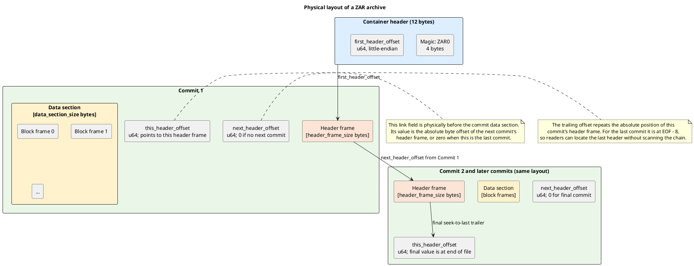
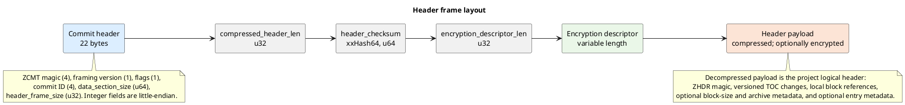
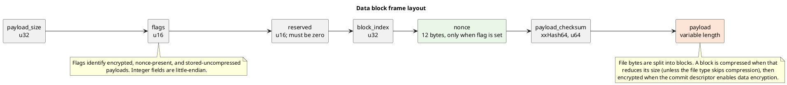

# ZAR file architecture

A ZAR archive is a container header followed by one or more physically
contiguous commits. The container points to the first commit's header frame.
Each commit stores its data blocks before its compressed logical header, and
the offset fields link the commits in order.

## Physical layout

The diagram shows the byte order for a two-commit archive. A one-commit
archive ends after its first `this_header_offset`. Repeated commits use the
same structure.

## Header frame

Each header frame begins at the offset named by the container or a commit
link. Its fixed fields are followed by the encryption descriptor and the
compressed (and, when configured, encrypted) logical-header payload.

## Data block frame

The data section is a sequence of block frames. A file entry in the logical
header refers to one or more block indices local to that commit. Blocks may
be compressed or stored uncompressed; encrypted blocks carry a nonce.

## Reading the structure

- `first_header_offset` is an absolute offset to the first header frame. A
  reader locates that frame, derives the commit data start by subtracting
  `data_section_size`, then reads the `next_header_offset` immediately before
  that data section to continue the chain.
- `this_header_offset` at the end of each commit points back to its header
  frame. The final value makes it possible to find the last commit from EOF.
- `data_section_size` covers only that commit's block frames. The 22-byte
  commit header and `header_frame_size` are part of the header frame.
- The header payload describes TOC operations, not a fully materialized final
  TOC. Applying commit changes in chain order reconstructs the archive's
  effective contents.
- Block checksums cover stored payload bytes; the header checksum covers the
  header payload bytes. Encrypted payloads also require successful AEAD
  authentication to read.

The frame definitions are implemented in [`zarlib/src/lib.rs`](../zarlib/src/lib.rs)
and [`zarlib/src/frames.rs`](../zarlib/src/frames.rs); the logical-header
encoding is in [`zarlib/src/header.rs`](../zarlib/src/header.rs).
