# `zarg` — ZAR Archive Manager

`zarg` is the native egui graphical companion to [`zarc`](../zarlib-cli/README.md).
It uses the same `zarlib` operations, so GUI-created archives use the same
format and validation as archives created by the CLI.

Tools > Cross-commit references opens Archive Information with per-commit
counts and the referencing commit, source commit, and path for each reference.

## Illustrated guide

The screenshots show the Windows build with the dark theme. Window appearance,
file pickers, and available options can differ by platform and archive state.

### Main window

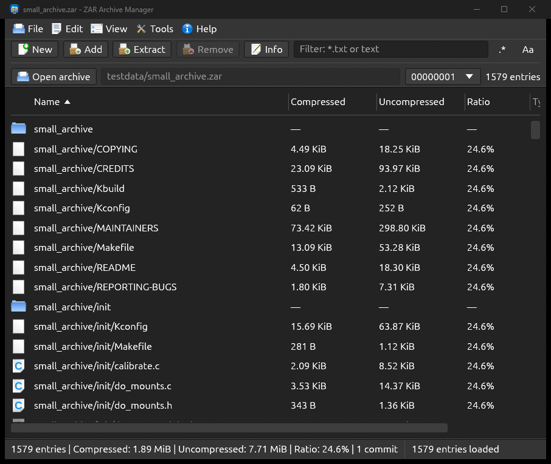

Open an archive, browse its entries, and select a revision with the commit
selector. The toolbar provides New, Add, Extract, Remove, and Info actions;
the filter narrows the visible entries. Use View to change layouts or sorting,
and the status bar to see aggregate sizes and commit counts. Double-click a
file to open a temporary extracted copy, or drag entries to another application.
File and folder drops open the Add dialog.
Use **Alt+N**, **Alt+O**, **Alt+A**, **Alt+E**, **Alt+I**, and **Alt+J** for New,
Open, Add, Extract, Info, and Join respectively, when those commands are available.
**Alt+F** opens Find when an archive can be searched.
**Ctrl+F** focuses the filter field.
Text fields support the platform's clipboard shortcuts; password fields allow
pasting but do not copy passwords to the clipboard.
**Ctrl+S** saves changes and **Ctrl+Shift+S** opens Save As.
In zarg's dialogs, **Alt+C** activates an enabled Close or Cancel button.
The main window requests focus at startup, and new dialogs request focus when
opened. The window manager may restrict activation.
With the file list focused, **Ctrl+A** selects visible entries, **Ctrl+I**
inverts the visible selection, **Delete** removes selected entries when
editing is allowed, and **Enter** opens the first selected entry in view order
if it is a file. If no selected entries are visible, Enter uses the first
selected path. Opening a file uses the same temporary-copy behavior as
double-clicking it.

### New archive

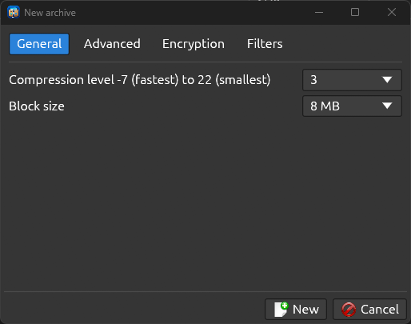

Choose **New** to configure a new archive. General sets compression level and
block size; Advanced controls metadata and input handling; Encryption chooses
the algorithm, scope, and password; Filters restrict the included paths. The
new archive starts as an unsaved session; add files and use **Save** or
**Save as** to write it.

### Add to archive

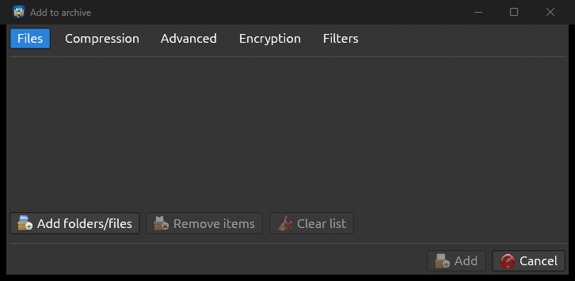

Use **Add** or drop files into the main window. Select inputs on the Files tab
and review compression, metadata, encryption, and filters on the other tabs.
The Unlock tab is available when existing encrypted commits need passwords.
Add records a new commit; the archive's existing history remains available.

### Extract

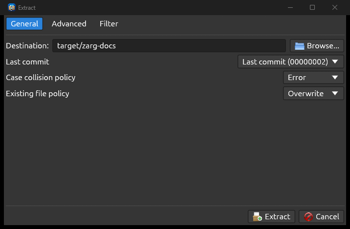

Choose a destination and revision, and decide how to handle case collisions
and existing files. General can restrict extraction to the current selection;
Advanced contains metadata, special-file, dry-run, and validation options.
Filter narrows the output, and Encryption appears for encrypted commits.
Selected folders include their contents. The **Ask** policies display a
question with **Yes**, **No**, **Yes to all**, **No to all**, and **Cancel**
options. **Cancel** stops the extraction; files already extracted remain in
place.
All-or-none choices apply to subsequent conflicts of the same kind during that
extraction. Review the safety notes below before restoring links or devices or
skipping validation of unselected frames.

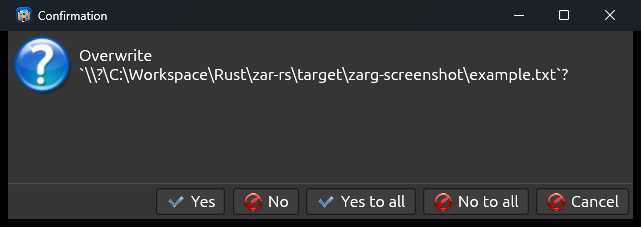

### Archive information

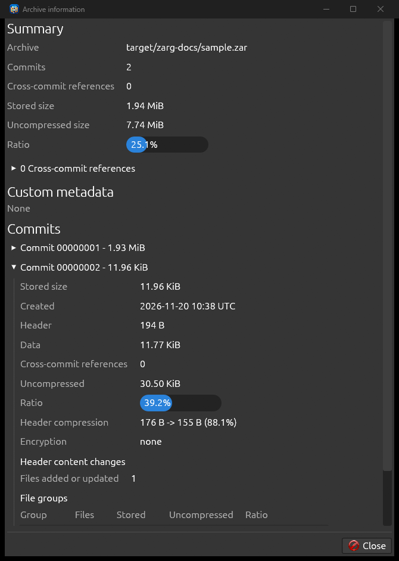

**Info** shows archive size, compression, metadata, and per-commit details.
Expand the cross-commit reference section to see which paths refer to data in
other commits. The displayed information depends on which encrypted commits
have been unlocked.

### Custom metadata

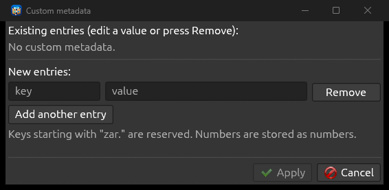

**Tools > Custom metadata** adds, edits, or removes archive-level key/value
pairs. Numbers are stored numerically and keys beginning with `zar.` are
reserved. Applying a change appends a metadata-only commit; these values are
separate from file ownership, permissions, and timestamps.

### Change commits

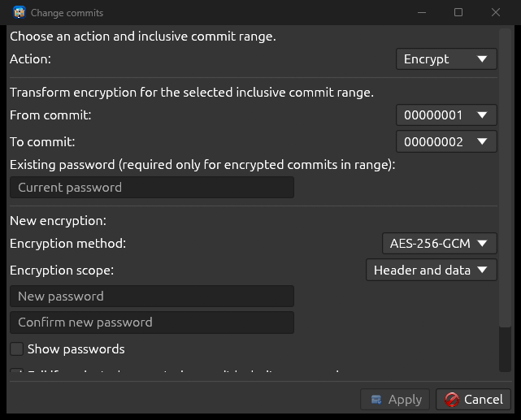

**Tools > Change commits** encrypts, decrypts, or changes encryption for an
inclusive commit range. Select the action and range, provide existing passwords
when needed, and choose the new encryption method and scope when applicable.
An optional output path leaves the open archive unchanged.

### Join commits

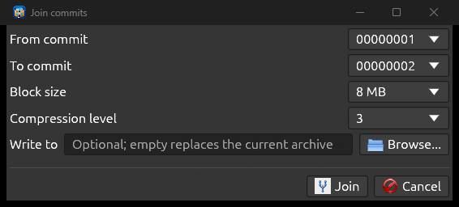

**Tools > Join commits** compacts a contiguous range into one commit. Choose
the range, compression settings, and optionally a separate output archive.
The state at the end of the range is retained, but its intermediate history
is discarded. Keep a separate backup when those states matter.

### Remove commits

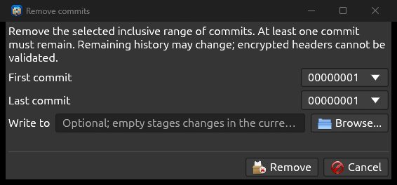

**Tools > Remove commits** removes an inclusive range while leaving at least
one commit. Later history can change or become invalid when commits are
removed. Encrypted headers that cannot be read prevent complete validation;
the GUI reports a warning. A separate output path preserves the open archive.

### Undo

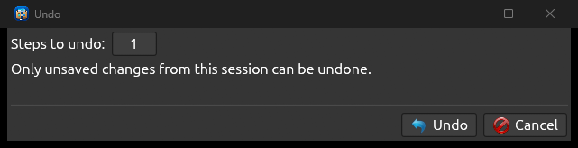

**Edit > Undo** reverses the requested number of unsaved session actions in
order. It does not remove previously saved history, and saving clears the
session's undo history.

### Find

**Edit > Find** searches regular files in a nonempty selected revision, including
unsaved changes. Enter an archive-relative filename glob (the default `*`
selects all files), search text, and optional numbers of context lines before
and after each match. **Regex** is enabled by default and supports lookaround
and backreferences; turn it off for literal text. **Aa** controls case-sensitive
matching. In literal mode, **Word** restricts matches to text not adjacent to
Unicode word characters. **Chain** limits each successful search to files
matched by the previous search, additionally applying the current filename
glob. Enabling Chain starts a new chain; an empty result keeps it empty until
Chain is toggled off and on. Failed or cancelled searches do not change it.
Results show paths and line numbers; matching text is bold, and line contents are limited to
250 displayed characters. Context lines appear in the same multiline result;
overlapping or adjacent context ranges are merged. Double-click a result to
extract and open its file with the default application. Press **Alt+F** to
search or **Enter** in the filename glob or search field to search. Searching
is disabled when the search field is empty. While
searching, **Cancel** or **Escape** stops the search and keeps results found so
far; otherwise **Close** closes the dialog. Cancelled results may be
incomplete, and files interrupted during the search may not have been fully
validated.
**Alt+C** activates the current button.
The status bar counts displayed results, including merged context groups.
Invalid UTF-8 bytes in results are displayed as replacement characters. Unlock
encrypted commits first when their passwords are needed for the search.
Matching is Unicode-aware; inline Unicode mode changes and matching individual
invalid UTF-8 bytes are not supported.

### Unsaved changes

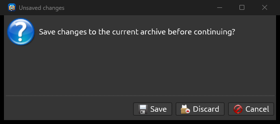

When leaving an archive with unsaved changes, choose **Save** to keep them,
**Discard** to continue without them, or **Cancel** to stay in the archive.

### Open encrypted archive

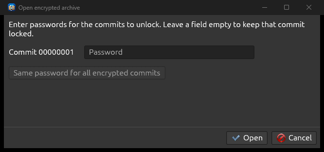

Enter passwords for the commits to unlock, or leave individual fields empty
to keep those commits locked. The first password can be copied to all encrypted
commits. A locked header can make the displayed archive view incomplete;
passwords are remembered in memory for the session, not saved to disk.

### Unlock commits

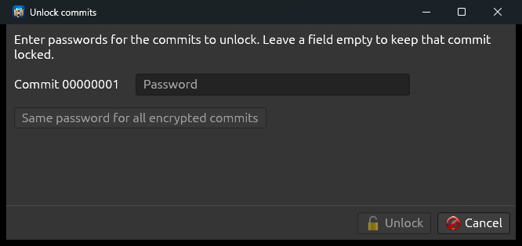

Use **Tools > Unlock commits** to unlock additional commits after opening the
archive. Enter passwords for the commits you need; leave the other fields blank
to keep those commits locked.

### Test archive

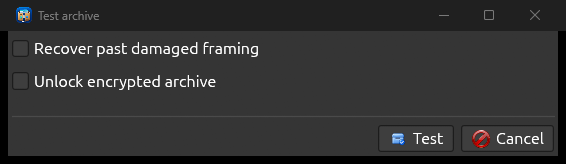

**Tools > Test archive** checks an archive and can unlock encrypted commits.
The recovery option scans past damaged framing; it reports damage rather than
repairing the archive. Testing can be canceled.

### Benchmark

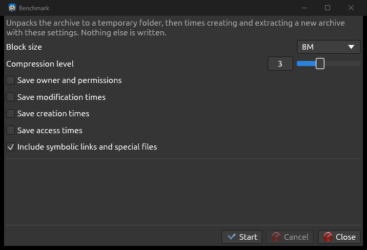

**Tools > Benchmark** tests compression settings on the current saved ZAR
archive. It extracts to temporary storage, then times creation and extraction
of a new, unencrypted archive; the original is unchanged. Results include size,
ratio, time, and throughput. Allow space for the temporary files, and repeat
runs for comparisons. See the [benchmark guide](../doc/benchmarks/README.md#benchmark-an-archive-in-zarg).

### Settings

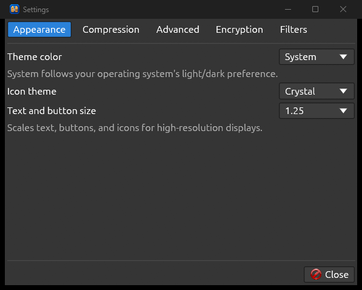

**Tools > Settings** (or **Alt+S**) controls appearance, UI scale, compression defaults,
input and extraction behavior, encryption defaults, and filters. These settings
prefill the operation dialogs; extraction filters are configured separately.
The **Performance** tab configures archive workers. CPU priority values lower
priority relative to the inherited priority; the available range is platform
dependent. On macOS, any negative value selects background scheduling.
Max CPU count ranges from minus to plus the available logical CPU count: zero
uses the available count, negative values reserve CPUs (at least one worker
remains), and positive values request that many workers. Memory limits may
reduce the actual count. **Environment** leaves the corresponding
`ZARLIB_CPU_PRIORITY` or `ZARLIB_MAX_CPU_COUNT` setting in effect. Explicit
choices override those variables without modifying the process environment.
Changes affect new worker pools, not workers already running.

### Errors and about

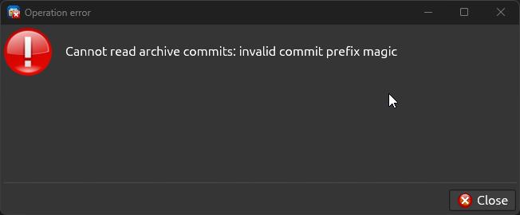

Errors describe the operation that failed. Review the message and preserve
the original archive before attempting recovery or another mutation.

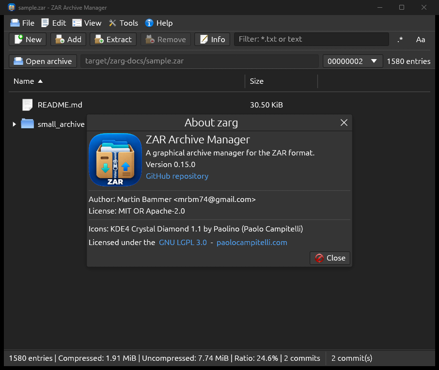

**Help > About zarg** displays the application version, project link, licenses,
and icon attribution.

## Run

From the workspace root:

```sh
cargo run --release -p zarlib-gui
```

For a release build using mimalloc, run `cargo build --release -p zarlib-gui --features mimalloc`.

The installer file-manager actions use the same startup interface as
`zarg --context ACTION -- PATH...`, where `ACTION` is `create`, `add`,
`create-named`, `open`, `extract-here`, `extract-to`, `extract-to-folder`, or
`test`. The `extract-to-folder` action extracts `foo.zar` into a sibling
directory named `foo` (the archive filename without `.zar`). The normal
no-argument launch opens the main window with a new, empty, unsaved archive
using the configured defaults. Opening a `.zar` file directly opens that
archive in the manager instead.
Save and Save as are unavailable while the latest archive state is empty, and
switching away from an empty archive does not prompt about unsaved changes.

The application is a desktop program built with eframe/egui. It uses a Qt6
Fusion appearance and follows the desktop's light or dark mode: Windows and
macOS report the theme through winit, while on Linux it is read from the XDG
settings portal (falling back to `gsettings`, KDE `kdeglobals`, GTK settings,
and `GTK_THEME`) and re-checked every few seconds, so switching the system
theme updates the running app. If no theme can be determined, light is used. On
Linux, native
file selection uses the XDG desktop portal. The PNG app icon and selected
Crystal and Flat icons for buttons and archive entry types are embedded in
the window binary. Select an icon theme in Settings; Crystal is the default.
Icon attribution and license information is in
[`assets/crystal/README.md`](./assets/crystal/README.md). Wayland requires a
matching desktop entry to show the app icon in the dock or app switcher;
`data/zarg.desktop` provides the entry. After installing the `zarg` executable,
install the launcher and icon with:

```sh
install -Dm644 zarlib-gui/data/zarg.desktop ~/.local/share/applications/zarg.desktop
install -Dm644 zarlib-gui/assets/zarg-icon.png ~/.local/share/icons/hicolor/256x256/apps/zarg.png
install -Dm644 zarlib-gui/data/zarg-error.desktop ~/.local/share/applications/zarg-error.desktop
install -Dm644 zarlib-gui/assets/zarg-error.png ~/.local/share/icons/hicolor/64x64/apps/zarg-error.png
```

The error dialog uses the `zarg-error` desktop identity so Wayland compositors
such as KDE Plasma can resolve its window and taskbar icon from the matching
desktop entry.

## Features

- Open and browse archives in a virtualized list with MIME-style icons,
  compressed/uncompressed sizes, ratio, and saved owner/permission metadata
  when available.
- Show the open archive's filename in the main window title.
- Select a commit beside the entry count to browse the archive through that
  commit; the latest commit is selected by default. Extraction and opening a
  file use the displayed revision. Removing entries requires the latest view;
  archive changes return the view to the latest commit.
- The idle status bar shows the selected revision's entry count, estimated
  compressed and uncompressed file sizes, and aggregate compression ratio,
  alongside the total number of commits in the archive. Unavailable estimates
  are shown as a dash; filters do not change these totals.
- Switch the archive contents between Normal icon tiles, Compact multi-column
  rows, Details with size, ratio, owner, permissions, and type columns, and a
  Structured expandable directory tree. Structured view shows file sizes and
  folder item counts. In Details and Structured views, Modified, Created,
  Accessed, Owner, and Permissions columns appear only when the displayed
  archive revision contains that metadata. In Details view, time columns follow
  the Type column.
  Compressed sizes are estimates based on the average compression ratio of
  their blocks; packed files use their shared block's ratio. Encrypted block
  ratios are unavailable unless the commit can be unlocked.
- Create and Add can optionally store modification, creation, and access times.
- Sort archive contents by name, modification, creation, or access time,
  compressed size, uncompressed size, ratio, or type. Time-based sort options
  appear only when the displayed archive revision contains that timestamp.
  When a saved time sort is unavailable, the list temporarily sorts by name.
  By default, times and sizes sort newest/largest first, ratio sorts lowest
  (best compression) first, and entries without the value come last. Reversing
  a sort reverses that order.
- In Details and Structured views, click a column header to sort by it (click
  again to reverse; a small arrow shows the active order) and drag the column
  borders to resize columns. Column widths and the main window's normal size
  and position are saved on exit. The position is ignored if the monitor count
  changed or cannot be determined; some window systems do not permit apps to
  restore window positions.
- Double-click a file to extract it to a temporary folder and open it with the
  operating system's default program.
- Press F2 to rename a selected entry, or drag selected entries onto a folder
  to move them within the archive. Drop onto an empty part of the list to move
  them to the archive root. These changes can be undone before saving.
- On Windows, macOS, X11, and Wayland, drag selected archive entries from the file
  list to another application. Selected folders include their contents.
  Entries are extracted to temporary storage before dragging so applications
  such as Dolphin can inspect the files during the drag. On Linux, the status
  bar shows extraction progress; keep the mouse button pressed until the drag
  begins. On Windows and macOS, the window is unresponsive during extraction.
  Temporary files remain until zarg exits and may include decrypted data.
  Selections containing symbolic links or special files cannot be dragged.
- Add, edit and remove custom archive metadata (key/value pairs) from the
  Custom metadata dialog. Values are archive-level and distinct from file
  permissions and timestamps. Saving a metadata change appends a commit with
  no file changes; later values override earlier ones, and removing a key hides
  its earlier value.
- Keep the 10 most recently opened archives available from File → Recent
  archives.
- Show `.zar` files with the dedicated bundled ZAR archive icon.
- Virtualize large archive listings so only visible rows are rendered.
- Create or append archives from selected files and folders with a dedicated
  options panel for ZAR's Zstandard compression level, block size,
  metadata/special-file handling, strict input checks, filters and overwrite
  behavior. Create and Add support AES-256-GCM or ChaCha20-Poly1305 encryption
  with header/data scope selection; Add can also unlock existing commits. A
  saved default password preselects encryption in these dialogs, which can still
  be unchecked.
- Drop files and folders onto the main window to populate the Add to archive
  dialog. Review the options and select Add to include them in the current
  archive. Imported read-only archives cannot be modified. File drops are
  supported on Windows, macOS, X11, and Wayland.
- Include a `.zip`, `.7z`, `.rar`, `.iso`, `.tar`, `.tar.gz`, `.tgz`, or
  standalone `.gz` file among Create or Add inputs to import its contents.
- Open those formats directly for read-only browsing and extraction; zarg
  creates a temporary ZAR snapshot and leaves the source archive unchanged.
- Remove selected archive entries or paths.
- Join a contiguous range of commits, or remove an inclusive range through
  Tools → Remove commits. At least one commit must remain; removing commits
  can change the resulting history. When retained encrypted headers prevent
  validation, zarg reports a warning.
- Edit → Undo reverses unsaved session changes in action order, without
  removing saved commit history. Saving clears the undo history.
- Encrypt, decrypt, or change encryption for commits through a unified dialog
  (Tools → Change commits). Choose an inclusive commit range and optionally
  write the result to a different archive without changing the open archive.
  Join and Remove commits also support a separate output archive. Leave "Write to" empty
  for an in-place staged change; an output path must differ from the open
  archive. Encryption offers AES-256-GCM or
  ChaCha20-Poly1305, with header/data scope selection.
- Test archives, optionally recovering past damaged framing.
- View commit information, including stored and uncompressed sizes, with
  optional verbose statistics or JSON output.
- List the latest archive state or select a commit and unlock encrypted
  headers with a password.
- Opening an archive with encrypted commits prompts for each commit's password.
  Leave a password blank to keep that commit locked, or copy the first
  password to all encrypted commits. Cancel leaves the current archive open.
  Successfully unlocked commit passwords are remembered in memory for the
  application session and reused in the Info and Add dialogs. Reopening the
  archive prefills its password fields; passwords are not saved to disk.
- Extract with collision and existing-file policies, optional metadata,
  symlink/device restoration, dry run, and commit selection. The Extract
  dialog has General, Advanced, and Filter tabs, plus an Encryption tab when
  the archive contains encrypted commits. Its default destination is the
  archive's containing folder, or the current directory for an unsaved archive.
  When entries are selected in the main window, General offers an option to
  extract only those entries. Selected folders include their contents; Filter
  tab rules still apply. The selection is captured when the dialog opens.
  Advanced can skip validation of unselected frames when a block index is
  available. Selected frames remain validated, but corruption in unselected
  frames may go undetected; archives without an index still scan all frames.
  After opening an archive or selecting a commit, zarg validates it in the
  background for repeated extraction without copying it. Zarg attempts to
  lock the open archive; on Unix this lock is advisory. It also checks the
  archive's size and modification time before reusing validation. If the
  archive changes or preparation fails, extraction reads it normally.
  Settings > Advanced offers **Validate selected blocks before extraction (slow)**
  to revalidate every block needed by the selected files before writing them.
  This also applies when opening or dragging files and can be slower.
  **Auto recheck block checksums during extraction** is the default: it
  rechecks when the archive being read is on a network or older filesystem
  such as FAT or exFAT. If the filesystem cannot be identified, it rechecks
  as a precaution. Select **Always recheck block checksums during extraction**
  to recheck on every filesystem, or **Never recheck block checksums during
  extraction** to disable the recheck. Without rechecking, changes after
  validation may not be detected. File checksums and encrypted-data
  authentication still apply. Existing enabled settings migrate to Always;
  previously disabled settings migrate to Never.
  Staged edits currently use a temporary combined archive for extraction.
- Configure block size, compression, strict input handling, special files,
  overwrite, and the CLI's fnmatch include/exclude filters and filter lists.
- Set defaults for metadata, dates, special files, strict input validation,
  username recording, and include/exclude patterns in Settings. These defaults
  prefill New archive, whose options are grouped into General, Advanced,
  Encryption, and Filters tabs. The first Add dialog for a new archive uses
  the New archive dialog's settings; for an opened archive it uses Settings defaults. Later
  Add dialogs remember their settings until another archive is created or opened
  or the application exits, including when the dialog is canceled. Selected
  input files and new-commit encryption passwords are not remembered.
- Settings are grouped into Appearance, Compression, Advanced, Encryption,
  and Filters tabs.
- New archive prompts to save unsaved changes only when the latest state is
  nonempty and the current archive's first commit contains entries.
  Add to archive groups its file list, compression, advanced, unlock,
  encryption, and filter options into separate tabs.
  The Unlock tab appears only for archives with encrypted commits and lets
  you select each commit and enter its password separately.
  Username recording applies only to new archives. Extraction filters remain
  independent.
- Use installed file-manager actions to create archives from selected items,
  open `.zar` files, extract, and test archives. “Add to Archive...” opens the
  create form and asks for a destination for a new archive. “Create Archive...”
  pre-fills the destination using the first selected item’s name with a `.zar`
  extension. “Extract to archive folder” extracts into a sibling directory
  named after the archive, without its `.zar` extension.
- Run long operations in a worker thread, with progress, warnings, results, and
  confirmation dialogs reported in the application.

Operations are provided by `zarlib`; encryption, file type and filesystem
safety behavior follows the library. In particular, archive append and
compaction retain the same encrypted-header limitations as `zarc`.

To measure compression and extraction of a saved archive with different
settings, see
[Benchmark an archive in zarg](../doc/benchmarks/README.md#benchmark-an-archive-in-zarg).
